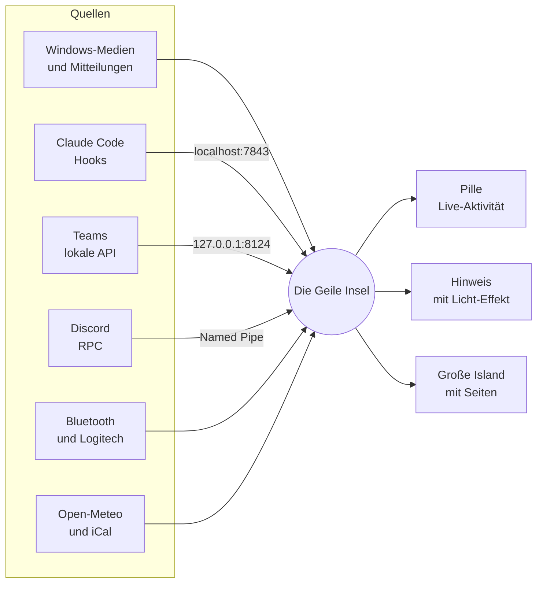

  

  
  
  
  

<h3 align="center">Dynamic Island für den Windows-Desktop</h3>

Live-Aktivitäten, Hinweise und Schnellzugriffe in einer schwarzen Pille oben am Bildschirm – mit Federanimationen, wischbaren Seiten und ohne Installation.

  
  &nbsp;
  

  <a href="#vorschau">Vorschau</a> ·
  <a href="#neu-in-14">Neu in 1.4</a> ·
  <a href="#funktionen">Funktionen</a> ·
  <a href="#so-funktioniert-es">So funktioniert es</a> ·
  <a href="#installation">Installation</a> ·
  <a href="#bedienung">Bedienung</a> ·
  <a href="#häufige-fragen">FAQ</a>

 

## Auf einen Blick

<table>
<tr>
<td width="33%" valign="top">
 
<b>Live-Aktivitäten</b> 
Musik, Timer, Downloads, Anrufe, Teams, Discord und Claude Code direkt in der Pille
</td>
<td width="33%" valign="top">
 
<b>Große Island mit Seiten</b> 
Übersicht, Wetter, Kalender, Player, Bluetooth, KI und To Do – seitlich wischen
</td>
<td width="33%" valign="top">
 
<b>Für Claude Code gemacht</b> 
Laufzeit im Kreis, aktuelles Werkzeug, Meldung bei „fertig“, Nutzungs-Limits
</td>
</tr>
<tr>
<td width="33%" valign="top">
 
<b>Medien und Geräte</b> 
Spotify und alle Windows-Player, AirPods-Akku, Logitech-Maus und -Tastatur
</td>
<td width="33%" valign="top">
 
<b>Komplett lokal</b> 
Keine Server, keine Telemetrie, Zugangsdaten mit Windows verschlüsselt
</td>
<td width="33%" valign="top">
 
<b>Eine einzige EXE</b> 
Herunterladen, starten, fertig – ohne Installation und ohne .NET
</td>
</tr>
</table>

## Vorschau

### Große Island

<table>
<tr>
<td width="50%" align="center"> <b>Seiten</b> · Übersicht, Wetter, Kopfhörer, KI – einheitliches Design</td>
<td width="50%" align="center"> <b>Wetter</b> · farbige Symbole, Stunden mit Tagesname</td>
</tr>
<tr>
<td width="50%" align="center"> <b>Teams</b> · Mikro, Kamera, Hand, Reaktionen, Verlassen</td>
<td width="50%" align="center"> <b>Logitech</b> · Akku von Maus und Tastatur</td>
</tr>
</table>

### Hinweise und Live-Aktivitäten

 <b>Ereignisse</b> · Nachricht, Claude fertig, Gerät verbunden – jeweils mit App-Logo

<table>
<tr>
<td width="50%" align="center"> <b>Claude Code</b> · Laufzeit im Kreis, Meldung bei „fertig“</td>
<td width="50%" align="center"> <b>Claude-Limits</b> · 5-Stunden- und Wochen-Limit, Warnung ab 80 %</td>
</tr>
<tr>
<td width="50%" align="center"> <b>Zwischenablage</b> · zeigt kurz den kopierten Inhalt</td>
<td width="50%" align="center"> <b>Hinweise</b> · Farbe und Logo passend zur App</td>
</tr>
</table>

### Licht-Effekte

<table>
<tr>
<td width="50%" align="center"> <b>Licht-Effekte</b> · Umlauf, Schein, Glanz, Rahmen</td>
<td width="50%" align="center"> <b>Lichtring</b> · läuft einmal um die ganze Island</td>
</tr>
</table>

### Katzen

 <b>Bis zu vier eigene Katzen</b> · Fell, Augen, Muster, Zubehör – auf dem Kratzbaum in der großen Island

## Neu in 1.4

<table>
<tr>
<td width="33%" valign="top">
<b>Microsoft Teams</b>
<ul>
<li>Seite im Teams-Look, nur in einer Besprechung und nach Kopplung</li>
<li>Mikro, Kamera, Hand, Chat, Unschärfe, Reaktionen, Verlassen</li>
<li>Aufnahme- und Teilen-Anzeige</li>
<li><kbd>Strg</kbd> + <kbd>Alt</kbd> + <kbd>M</kbd> schaltet das Teams-Mikro</li>
</ul>
</td>
<td width="33%" valign="top">
<b>Neues Design</b>
<ul>
<li>Übersicht im Apple-Stil: Datum über großer Uhr, Wetter oder Player, runde Knöpfe</li>
<li>alle Seiten mit einheitlicher Kopfzeile und Karten</li>
<li>Discord-Seite im Discord-Look mit grünem Sprechrahmen</li>
</ul>
</td>
<td width="33%" valign="top">
<b>Vorschau</b>
<ul>
<li>neue, größere Animationen</li>
<li>Übersicht, Teams und Ereignisse neu dabei</li>
</ul>
</td>
</tr>
</table>

<b>Neu in 1.3</b>

- **Wetter und Kalender als eigene Seiten**
  - einzeln an- und abschaltbar
  - Wetter optional zusätzlich auf der Kalender-Seite
- **Farbige Wetter-Symbole**
  - in der kleinen Uhr-Ansicht, auf der Wetter-Seite und im Widget
  - Stunden mit Tagesname („So 19“)
- **Schrift und Stil der Seiten einstellbar**
  - Schriftgröße: Normal, Groß, Größer, Sehr groß – die Island bleibt gleich groß
  - Stil: Aufgeräumt (weniger, größer) oder Ausführlich
  - global oder pro Seite (Knopf „Aa“ unter Seiten & Widgets)
- **Feinschliff**
  - größere Seitensymbole in der großen Island
  - Datum mit vollem Wochentag
  - Antworten-Knopf nur noch bei Chat-Apps
  - Kalender zeigt Ladefehler statt „Wird geladen …“
  - keine „-0°“-Anzeige mehr

<b>Neu in 1.2</b>

- Claude-Laufzeit zählt ab der eigenen Nachricht, auch nach Neustart der Island
- Claude-Limits nur noch mit echten Werten aus Claude Code
- Logitech: schlafende Maus behält den letzten Akkustand

<b>Neu in 1.1</b>

- Obsidian: Text, Links und Dateien auf die Island ziehen, landen in der Inbox
- Mehrere KI-Anbieter: Gemini, ChatGPT, Grok, Claude, Mistral, DeepSeek, OpenRouter
- Anrufe annehmen (WhatsApp, Teams, Discord), App-Logo bei jeder Mitteilung
- Claude per Spracheingabe, Katzen-Laune nach Tageszeit und Wetter, Suche in den Einstellungen

## Funktionen

| Bereich | Funktion |
|---|---|
| **Medien** | Player für Spotify und alle Windows-Medien, Cover mit Farbleuchten, Player-Wechsler |
| **Wetter** | Open-Meteo ohne Konto, jetzt, nächste Stunden, nächste Tage |
| **Kalender** | iCal-Adressen (Google, Outlook, iCloud), Erinnerung, Ansage, „Beitreten“ für Meetings |
| **Claude Code** | Laufzeit, aktuelles Werkzeug, Fertig-Meldung, Nutzungs-Limits, Spracheingabe |
| **Nachrichten** | Windows-Mitteilungen mit App-Logo, Antworten aus der Island (Chat-Apps) |
| **Anrufe** | WhatsApp, Teams, Discord annehmen oder ablehnen |
| **Discord** | Sprachkanal mit Teilnehmern, Stummschalten, Stream beenden |
| **Teams** | Besprechung steuern: Mikro, Kamera, Hand, Chat, Reaktionen, Verlassen |
| **AirPods & Kopfhörer** | Akku, Ohrerkennung, Wiedergabegerät |
| **Logitech** | Akku von Maus und Tastatur, Warnung nur bei wenig Akku |
| **Downloads** | Browser, Steam und Epic mit Fortschritt und Restzeit |
| **Zwischenablage** | Verlauf der letzten 25 Einträge, nur im Arbeitsspeicher |
| **Timer** | Countdown und Pomodoro in der Pille |
| **KI** | Chat mit mehreren Anbietern, Texterkennung vom Bildschirm |
| **Obsidian** | Inhalte per Drag & Drop in die Inbox |
| **Katzen** | Bis zu vier eigene Katzen mit Kratzbaum in der großen Island |

## So funktioniert es

- Jede Quelle meldet sich als Live-Aktivität, die wichtigste steht in der Pille
- Ereignisse erscheinen kurz als Hinweis und verschwinden von selbst
- Alles läuft auf dem eigenen Rechner, nur Wetter und Kalender werden aus dem Netz geladen

## Anpassen

| | |
|---|---|
| **Größe** | große Island, Breite, alles skalieren, Position |
| **Seiten** | Reihenfolge, an/aus, eigene Widget-Seiten |
| **Schrift & Stil** | global oder pro Seite |
| **Aussehen** | Form, Design, Akzentfarbe, farbige oder weiße Seitensymbole |
| **Hinweise** | welche Ereignisse, Dauer, Reihenfolge |
| **Animationen** | pro Ereignis App, Leuchten, Hüpfen, Licht-Effekt oder aus |
| **Uhr** | Format, Datum, Sekunden, Wetter in der kleinen Ansicht |

## Installation

1. [`DynamicIsland.exe`](https://github.com/SNIWI/DieGeileInsel/releases/latest/download/DynamicIsland.exe) herunterladen
2. Starten – die Island erscheint oben in der Mitte
3. Rechtsklick → Einstellungen → „Mit Windows starten“ für Autostart

> [!NOTE]
> Beim ersten Start kann Windows SmartScreen warnen: „Weitere Informationen“ → „Trotzdem ausführen“.

| Voraussetzung | |
|---|---|
| **System** | Windows 10 (ab 19041) oder Windows 11, x64 |
| **Laufzeit** | keine – .NET ist in der EXE enthalten |
| **Optional** | Spotify-Konto, Discord, Microsoft Teams (neu), Claude Code, Microsoft To Do |

<b>Selbst bauen</b>

- Voraussetzung: [.NET 8 SDK](https://dotnet.microsoft.com/download)
- `Starten.bat` – bauen und starten
- `Als-EXE-bauen.bat` – einzelne `DynamicIsland.exe` im Ordner `Fertige App`

## Bedienung

| Geste | Aktion |
|---|---|
| Antippen | Island entfalten, erneut: Übersicht |
| Gedrückt halten | direkt zur Übersicht |
| Seitlich wischen / Mausrad | Seite wechseln |
| Seitensymbol antippen | direkt zur Seite |
| Rechte Maustaste ziehen | Island verschieben |
| Rechtsklick | Menü mit allen Funktionen |

### Tastenkürzel

| Kürzel | Aktion |
|---|---|
| <kbd>Strg</kbd> + <kbd>Alt</kbd> + <kbd>Leertaste</kbd> | Übersicht |
| <kbd>Strg</kbd> + <kbd>Alt</kbd> + <kbd>K</kbd> | Kurzbefehle |
| <kbd>Strg</kbd> + <kbd>Alt</kbd> + <kbd>D</kbd> | Downloads |
| <kbd>Strg</kbd> + <kbd>Alt</kbd> + <kbd>M</kbd> | Mikro an/aus (Teams in einer Besprechung, sonst Discord) |
| <kbd>Strg</kbd> + <kbd>Alt</kbd> + <kbd>V</kbd> | Zwischenablage-Verlauf |
| <kbd>Strg</kbd> + <kbd>Alt</kbd> + <kbd>A</kbd> | App-Wechsler |
| <kbd>Strg</kbd> + <kbd>Alt</kbd> + <kbd>G</kbd> | KI-Chat |
| <kbd>Strg</kbd> + <kbd>Alt</kbd> + <kbd>T</kbd> | Text vom Bildschirm erkennen |
| <kbd>Strg</kbd> + <kbd>Alt</kbd> + <kbd>N</kbd> | neue Aufgabe (To Do) |

## Häufige Fragen

<b>Wie verbinde ich Claude Code?</b>

- Einstellungen → Claude → „Mit Claude Code verbinden“
- Die Island trägt die Hooks in `%USERPROFILE%\.claude\settings.json` ein
- Ab der nächsten Nachricht an Claude erscheint der Kreis mit der Laufzeit

<b>Wie verbinde ich Microsoft Teams?</b>

- In Teams: Einstellungen → Datenschutz → „Drittanbieter-App-API“ aktivieren
- In der Island: Einstellungen → Teams → „Mit Teams verbinden“
- In der nächsten Besprechung „Mit Teams koppeln“ antippen und in Teams „Zulassen“ wählen
- Die Teams-Seite erscheint nur während einer Besprechung

<b>Warum sehe ich keine Claude-Limits?</b>

- Die Limits sendet nur Claude Code im Terminal (Pro/Max), die Claude-App nicht
- Angezeigt werden nur echte Werte, nie Schätzungen

<b>Wo liegen meine Daten?</b>

- Einstellungen in `%APPDATA%\DynamicIsland`
- KI-Schlüssel, To-Do-Token und Kalender-Adressen sind mit Windows (DPAPI) verschlüsselt
- Der Zwischenablage-Verlauf wird nie gespeichert

<b>Wie bekomme ich die Island weg oder an eine andere Stelle?</b>

- Mit der rechten Maustaste ziehen verschiebt sie
- Rechtsklick → Beenden schließt sie
- Unter Einstellungen → Allgemein → „Größe & Position“ lässt sie sich skalieren

## Datenschutz

- Keine eigenen Server, keine Telemetrie
- Lokale API nur auf `localhost`
- Wetter: nur der Ort wird an Open-Meteo übertragen
- Zwischenablage-Verlauf nur im Arbeitsspeicher, passwortähnliche Einträge verdeckt

## Technik

- WPF / .NET 8, Code-only UI ohne XAML
- Lokale API auf `localhost:7843` (Hinweise, Claude-Hooks, Seiten)
- Vollständige Beschreibung: [SPEZIFIKATION.md](SPEZIFIKATION.md)

 

Die Geile Insel · gebaut für Windows · <a href="https://github.com/SNIWI/DieGeileInsel/releases">Releases</a> · <a href="SPEZIFIKATION.md">Spezifikation</a>

