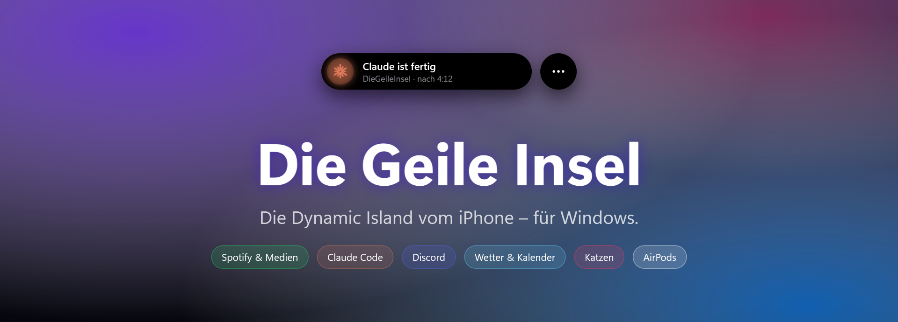
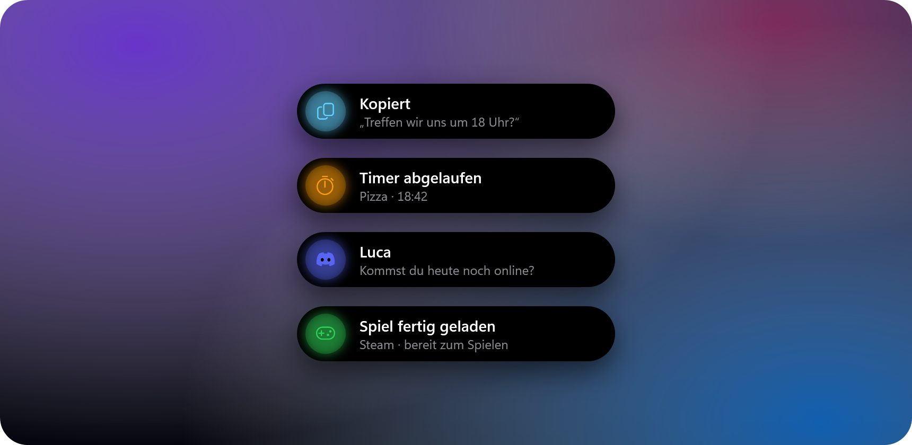
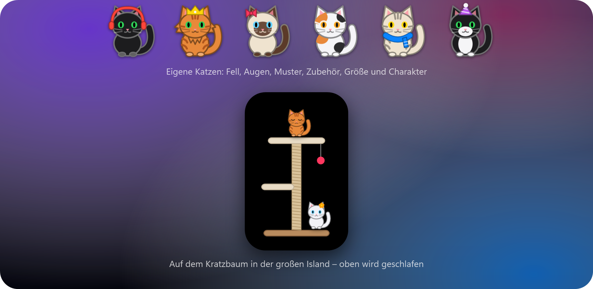
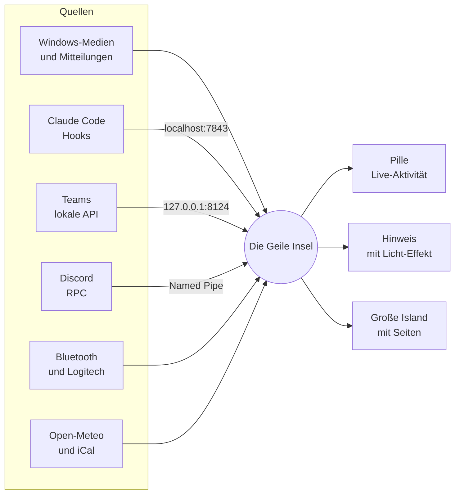

# Die Geile Insel

**Die Geile Insel bringt die Dynamic Island des iPhones auf den Windows-Desktop: eine schwarze Pille oben am Bildschirm, die Musik, Claude Code, Nachrichten, Teams-Besprechungen und Geräte live zeigt – mit Federanimationen, wischbaren Seiten und ohne Installation.**

<p align="center">
  
</p>

<p align="center">
  
  
  
  
</p>

<p align="center">
  <a href="https://github.com/SNIWI/DieGeileInsel/releases/latest/download/DynamicIsland.exe"></a>
  &nbsp;
  <a href="https://github.com/SNIWI/DieGeileInsel/releases"></a>
</p>

<p align="center">
  <a href="#überblick">Überblick</a> ·
  <a href="#beispiel">Beispiel</a> ·
  <a href="#erste-schritte">Erste Schritte</a> ·
  <a href="#designziele">Designziele</a> ·
  <a href="#nutzung-im-detail">Nutzung</a> ·
  <a href="#vergleichbare-tools">Vergleich</a> ·
  <a href="#für-entwickler">Entwickler</a> ·
  <a href="#kolophon">Kolophon</a>
</p>

<p align="center"></p>

## Überblick

### Was sie macht

- Zeigt Live-Aktivitäten in einer Pille oben am Bildschirm: Musik, Timer, Downloads, Anrufe, Teams- und Discord-Gespräche, Claude Code
- Blendet Hinweise kurz ein: Nachrichten mit App-Logo, „Claude ist fertig“, Gerät verbunden, Termine
- Klappt zu einer großen Island mit wischbaren Seiten auf: Übersicht, Wetter, Kalender, Player, Kopfhörer, KI, To Do
- Läuft komplett lokal als einzelne EXE

<table>
<tr>
<td width="33%" valign="top">
<br>
<b>Live-Aktivitäten</b><br>
<sub>Musik, Timer, Downloads, Anrufe, Teams, Discord und Claude Code direkt in der Pille</sub>
</td>
<td width="33%" valign="top">
<br>
<b>Große Island mit Seiten</b><br>
<sub>Übersicht, Wetter, Kalender, Player, Kopfhörer, KI und To Do – seitlich wischen</sub>
</td>
<td width="33%" valign="top">
<br>
<b>Für Claude Code gemacht</b><br>
<sub>Laufzeit im Kreis, aktuelles Werkzeug, Meldung bei „fertig“, Nutzungs-Limits</sub>
</td>
</tr>
<tr>
<td width="33%" valign="top">
<br>
<b>Medien und Geräte</b><br>
<sub>Spotify, YouTube Music, Deezer, TIDAL und jeder Windows-Player; Kopfhörer, Logitech</sub>
</td>
<td width="33%" valign="top">
<br>
<b>Komplett lokal</b><br>
<sub>Keine Server, keine Telemetrie, Zugangsdaten mit Windows verschlüsselt</sub>
</td>
<td width="33%" valign="top">
<br>
<b>Eine einzige EXE</b><br>
<sub>Herunterladen, starten, fertig – ohne Installation und ohne .NET</sub>
</td>
</tr>
</table>

### Warum du sie nutzen solltest

- Du willst sehen, was läuft, ohne Fenster zu wechseln: Song, Timer, Download, Claude-Fortschritt
- Du arbeitest mit Claude Code und willst wissen, wann es fertig ist oder auf dich wartet
- Du magst die Bedienung und Animationen der iPhone-Dynamic-Island

### Warum vielleicht nicht

- Nur für Windows 10 und 11 (x64)
- Die EXE ist nicht signiert – Windows SmartScreen warnt beim ersten Start
- Einige Funktionen brauchen Einrichtung: Spotify-Konto, Discord-Anwendung, Teams-API, iCal-Adressen, KI-Schlüssel
- Die Oberfläche ist nur auf Deutsch

## Beispiel

Die Island hat eine lokale Schnittstelle. Damit lässt sich aus jedem Skript ein eigener Hinweis anzeigen – hier ein Spielstand mit Licht-Effekt:

```powershell
Invoke-RestMethod "http://localhost:7843/show?id=spiel&title=FCB%202:1%20BVB&right=67'&icon=E7FC&glow=orbit"
```

Wieder entfernen:

```powershell
Invoke-RestMethod "http://localhost:7843/hide?id=spiel"
```

Weitere Beispiele unter [Lokale Schnittstelle](#lokale-schnittstelle).

## Erste Schritte

### Installation

1. [`DynamicIsland.exe`](https://github.com/SNIWI/DieGeileInsel/releases/latest/download/DynamicIsland.exe) herunterladen
2. Starten – die Island erscheint oben in der Mitte
3. Rechtsklick → Einstellungen → „Mit Windows starten“ für Autostart

> [!NOTE]
> Beim ersten Start kann Windows SmartScreen warnen: „Weitere Informationen“ → „Trotzdem ausführen“.

| Voraussetzung | |
|---|---|
| **System** | Windows 10 (ab 19041) oder Windows 11, x64 |
| **Laufzeit** | keine – .NET ist in der EXE enthalten |
| **Optional** | Spotify-Konto, Discord, Microsoft Teams (neu), Claude Code, Microsoft To Do |

### Aus dem Quellcode starten

- Voraussetzung: [.NET 8 SDK](https://dotnet.microsoft.com/download)
- `Starten.bat` – bauen und starten
- `Als-EXE-bauen.bat` – einzelne `DynamicIsland.exe` im Ordner `Fertige App`
- Automatische Tests gibt es noch nicht; geprüft wird über die Ereignis-Vorschau (`/test`, siehe unten) und den Demo-Modus

### Wo was liegt

| | |
|---|---|
| **Code** | dieses Repository |
| **Fehler melden, Wünsche** | [Issues](https://github.com/SNIWI/DieGeileInsel/issues) |
| **Downloads** | [Releases](https://github.com/SNIWI/DieGeileInsel/releases) |
| **Änderungen je Version** | [CHANGELOG.md](CHANGELOG.md) |
| **Vollständige technische Beschreibung** | [SPEZIFIKATION.md](SPEZIFIKATION.md) |

## Designziele

- **Unaufdringlich:** sichtbar nur bei Hinweisen oder wenn du sie hervorholst, sonst fährt sie nach oben weg
- **Apple-Gefühl:** Federanimationen, ruhige Typografie, Lichteffekte statt Pop-ups
- **Leicht statt überladen:** eine EXE, keine Installation, keine Hintergrunddienste
- **Lokal:** keine eigene Cloud, externe Dienste nur nach Einrichtung durch dich
- **Persönlich:** Farben, Größe, Schrift, Seiten, Animationen und Katzen frei einstellbar

## Nutzung im Detail

### Vorschau

#### Große Island

<table>
<tr>
<td width="50%" align="center"><br><sub><b>Seiten</b> · Übersicht, Wetter, Kopfhörer, KI – einheitliches Design</sub></td>
<td width="50%" align="center"><br><sub><b>Wetter</b> · farbige Symbole, Tag antippen für die Stunden</sub></td>
</tr>
<tr>
<td width="50%" align="center"><br><sub><b>Teams</b> · Mikro, Kamera, Hand, Reaktionen, Verlassen</sub></td>
<td width="50%" align="center"><br><sub><b>Logitech</b> · Akku von Maus und Tastatur</sub></td>
</tr>
</table>

#### Hinweise und Live-Aktivitäten

<p align="center"><br><sub><b>Ereignisse</b> · Nachricht, Claude fertig, Gerät verbunden – jeweils mit App-Logo</sub></p>

<table>
<tr>
<td width="50%" align="center"><br><sub><b>Claude Code</b> · Laufzeit im Kreis, Meldung bei „fertig“</sub></td>
<td width="50%" align="center"><br><sub><b>Claude-Limits</b> · 5-Stunden- und Wochen-Limit, Warnung ab 80 %</sub></td>
</tr>
<tr>
<td width="50%" align="center"><br><sub><b>Zwischenablage</b> · zeigt kurz den kopierten Inhalt</sub></td>
<td width="50%" align="center"><br><sub><b>Hinweise</b> · Farbe und Logo passend zur App</sub></td>
</tr>
</table>

#### Licht-Effekte

<table>
<tr>
<td width="50%" align="center"><br><sub><b>Licht-Effekte</b> · Umlauf, Schein, Glanz, Rahmen – auch mehrere gleichzeitig</sub></td>
<td width="50%" align="center"><br><sub><b>Lichtring</b> · läuft einmal um die ganze Island</sub></td>
</tr>
</table>

#### Katzen

<p align="center"><br><sub><b>Bis zu vier eigene Katzen</b> · Fell, Augen, Muster, Zubehör – auf dem Kratzbaum in der großen Island</sub></p>

### Funktionen

| Bereich | Funktion |
|---|---|
| **Medien** | Spotify mit Playlists und Geräten; jeder Windows-Player; erkennt YouTube Music, Deezer, TIDAL, Amazon Music, Apple Music, SoundCloud, VLC und weitere |
| **Wetter** | Open-Meteo ohne Konto, Wochenübersicht, Stunden je Tag auf Knopfdruck |
| **Kalender** | iCal-Adressen (Google, Outlook, iCloud), Erinnerung, Ansage, „Beitreten“ für Meetings |
| **Claude Code** | Laufzeit, aktuelles Werkzeug, Fertig-Meldung, Nutzungs-Limits, Spracheingabe |
| **Nachrichten** | Windows-Mitteilungen mit App-Logo, Verlauf der letzten 30, Antworten aus der Island |
| **Anrufe** | WhatsApp, Teams, Discord annehmen oder ablehnen |
| **Discord** | Sprachkanal mit Teilnehmern, Stummschalten, Stream beenden |
| **Teams** | Besprechung steuern: Mikro, Kamera, Hand, Chat, Reaktionen, Verlassen |
| **Kopfhörer** | Akku und Wiedergabegerät; AirPods-Funktionen mit WPods auf Wunsch |
| **Logitech** | Akku von Maus und Tastatur, Warnung nur bei wenig Akku |
| **Downloads** | Browser, Steam und Epic mit Fortschritt und Restzeit |
| **Zwischenablage** | Verlauf der letzten 25 Einträge, nur im Arbeitsspeicher |
| **Timer** | Countdown und Pomodoro in der Pille |
| **KI** | Chat mit mehreren Anbietern, Texterkennung vom Bildschirm |
| **Obsidian** | Inhalte per Drag & Drop in die Inbox |
| **Katzen** | Bis zu vier eigene Katzen mit Kratzbaum in der großen Island |

### Bedienung

| Geste | Aktion |
|---|---|
| Antippen | Island entfalten, erneut: Übersicht |
| Gedrückt halten | direkt zur Übersicht |
| Seitlich wischen / Mausrad | Seite wechseln |
| Seitensymbol antippen | direkt zur Seite |
| Rechte Maustaste ziehen | Island verschieben |
| Rechtsklick | Menü mit allen Funktionen |
| Kurz nach „Claude ist fertig“ antippen | Meldung kommt zurück |

| Kürzel | Aktion |
|---|---|
| <kbd>Strg</kbd> + <kbd>Alt</kbd> + <kbd>Leertaste</kbd> | Übersicht |
| <kbd>Strg</kbd> + <kbd>Alt</kbd> + <kbd>K</kbd> | Kurzbefehle |
| <kbd>Strg</kbd> + <kbd>Alt</kbd> + <kbd>D</kbd> | Downloads |
| <kbd>Strg</kbd> + <kbd>Alt</kbd> + <kbd>M</kbd> | Mikro an/aus (Teams in einer Besprechung, sonst Discord) |
| <kbd>Strg</kbd> + <kbd>Alt</kbd> + <kbd>V</kbd> | Zwischenablage-Verlauf |
| <kbd>Strg</kbd> + <kbd>Alt</kbd> + <kbd>A</kbd> | App-Wechsler |
| <kbd>Strg</kbd> + <kbd>Alt</kbd> + <kbd>G</kbd> | KI-Chat |
| <kbd>Strg</kbd> + <kbd>Alt</kbd> + <kbd>T</kbd> | Text vom Bildschirm erkennen |
| <kbd>Strg</kbd> + <kbd>Alt</kbd> + <kbd>N</kbd> | neue Aufgabe (To Do) |

### Einstellungen

| | |
|---|---|
| **Größe** | große Island, Breite, alles skalieren, Position |
| **Seiten** | Reihenfolge, an/aus, eigene Widget-Seiten |
| **Schrift & Stil** | global oder pro Seite |
| **Aussehen** | Form, Design, Akzentfarbe, farbige oder weiße Seitensymbole |
| **Hinweise** | welche Ereignisse, Dauer, Reihenfolge |
| **Animationen** | pro Ereignis App, Licht und Hüpfen frei kombinierbar; mehrere Licht-Effekte; Farbe pro Ereignis, App und Gerät |
| **Uhr** | Format, Datum, Sekunden, Wetter in der kleinen Ansicht |

Gespeichert wird alles in `%APPDATA%\DynamicIsland\einstellungen.json`.

### Einrichtung von Diensten

<details>
<summary><b>Claude Code verbinden</b></summary>

- Einstellungen → Claude → „Mit Claude Code verbinden“
- Die Island trägt Hooks in `%USERPROFILE%\.claude\settings.json` ein
- Ab der nächsten Nachricht an Claude erscheint der Kreis mit der Laufzeit
- Nutzungs-Limits sendet nur Claude Code im Terminal (Pro/Max), die Claude-App nicht
</details>

<details>
<summary><b>Microsoft Teams verbinden</b></summary>

- In Teams: Einstellungen → Datenschutz → „Drittanbieter-App-API“ aktivieren
- In der Island: Einstellungen → Teams → „Mit Teams verbinden“
- In der nächsten Besprechung „Mit Teams koppeln“ antippen und in Teams „Zulassen“ wählen
- Die Teams-Seite erscheint nur während einer Besprechung
</details>

<details>
<summary><b>AirPods-Funktionen</b></summary>

- Standard: AirPods laufen wie alle Kopfhörer (Akku, Wiedergabegerät)
- Einstellungen → Kopfhörer → „AirPods-Funktionen (mit WPods)“ schaltet AirPods-Karte, Ohrerkennung und Automatik ein
- Geräuschkontrolle und Konversationserkennung brauchen zusätzlich den Dienst der freien App [WPods](https://github.com/FPNDev/wpods)
</details>

### Lokale Schnittstelle

Läuft nur auf diesem PC unter `http://localhost:7843`.

| Route | Zweck |
|---|---|
| `GET /show` | eigene Aktivität anzeigen (`id`, `title`, `sub`, `right`, `icon`, `color`, `progress`, `banner=1`, `seconds`, `glow`) |
| `GET /hide?id=…` | Aktivität entfernen |
| `GET /page?key=…` | Seite öffnen (`weather`, `calendar`, `messages` …), `close` = zuklappen |
| `GET /settings?page=…` | Einstellungen öffnen |
| `GET /test?event=…` | Ereignis-Animation vorführen (`message`, `claude`, `timer`, `download`, `copy`, `device`) |
| `POST /claude` | Claude-Code-Hook-JSON |

```powershell
# Fortschrittsbalken, der sich aktualisieren lässt
Invoke-RestMethod "http://localhost:7843/show?id=backup&title=Backup&progress=0.4&icon=E896"
```

### So funktioniert es



- Jede Quelle meldet sich als Live-Aktivität, die wichtigste steht in der Pille, die zweite im Kreis daneben
- Ereignisse erscheinen kurz als Hinweis, stellen sich bei Bedarf an und verschwinden von selbst
- Nur Wetter, Kalender und eingerichtete Dienste gehen ins Netz

### Häufige Fragen

<details>
<summary><b>Warum sehe ich keine Claude-Limits?</b></summary>

- Die Limits sendet nur Claude Code im Terminal (Pro/Max), die Claude-App nicht
- Angezeigt werden nur echte Werte, nie Schätzungen
</details>

<details>
<summary><b>Zählt ein USB-Stick als Gerät?</b></summary>

- Ja, er löst „Gerät verbunden“ aus und kann eine eigene Farbe bekommen (Name = Laufwerksname)
</details>

<details>
<summary><b>Wie bekomme ich die Island weg oder an eine andere Stelle?</b></summary>

- Mit der rechten Maustaste ziehen verschiebt sie
- Rechtsklick → Beenden schließt sie
- Unter Einstellungen → Allgemein → „Größe & Position“ lässt sie sich skalieren
</details>

## Vergleichbare Tools

| Tool | Plattform | Unterschied |
|---|---|---|
| [DynamicWin](https://github.com/FlorianButz/DynamicWin) | Windows | ebenfalls von der Dynamic Island inspiriert, Open Source |
| [boring.notch](https://github.com/TheBoredTeam/boring.notch) | macOS | nutzt die Notch des MacBooks, Open Source |
| NotchNook | macOS | kommerzielle App für die Notch des MacBooks |

Die Geile Insel unterscheidet sich vor allem durch die Claude-Code-Anbindung, Teams/Discord-Steuerung, die lokale Schnittstelle und die deutsche Oberfläche.

## Für Entwickler

### Wichtige Bausteine

| Baustein | Aufgabe |
|---|---|
| `IslandWindow` | Fenster, Layout, Gesten, Takt (50 ms), Menüs, lokale API |
| `Activity` / `GenericActivity` | jede Anzeige mit kompakter, runder und großer Ansicht |
| `SetupWindow` | Einstellungen im Stil der Apple-Systemeinstellungen |
| `ClaudeTracker` | eine Claude-Aktivität pro Sitzung aus den Hooks |
| `MediaService` / `SpotifyService` | Windows-Medien, Musikdienst-Erkennung, Spotify Web API |
| `Settings` | JSON-Einstellungen mit Migrationen |

### Aufbau des Codes

```text
DynamicIsland/
├─ Program.cs          Einstieg, Einzelinstanz, Fehlerprotokoll
├─ IslandWindow.cs     Fenster, Layout, Gesten, Ereignisse, API-Routen
├─ SetupWindow.cs      Einstellungsfenster
├─ Ui.cs               Design-Bausteine, Farben, Federanimation
├─ Activities/         Anzeigen: Player, Wetter, Kalender, Claude, Teams, Discord, Katzen …
├─ Services/           Dienste: Medien, Spotify, Claude, Teams, Discord, Wetter, AirPods …
└─ docs/               Bilder und Animationen für dieses README
```

Ausführlich in [SPEZIFIKATION.md](SPEZIFIKATION.md), Abschnitt 14.

### Grenzen und bekannte Probleme

- Musikdienste außer Spotify werden nur erkannt, gesteuert wird über Windows-Medien
- Browser-Tabs sind nur als Musikdienst erkennbar, wenn der Songtitel im Fenstertitel steht
- Teams: Kopplung nur während einer Besprechung; Teilnehmerliste liefert die Schnittstelle nicht
- Spotify-, Discord- und Teams-Tokens liegen noch unverschlüsselt in den Einstellungen
- Epic-Downloads ohne Prozent, Steam-Fortschritt teils sprunghaft

Vollständige Liste: [SPEZIFIKATION.md](SPEZIFIKATION.md), Abschnitt 15.

### Leistung

- Ein Takt von 50 ms für Animationen und Abfragen; Wetter alle 15 Minuten, Logitech alle 2 Minuten
- Die eigenständige EXE ist rund 78 MB groß, weil .NET enthalten ist

### Datenschutz

- Keine eigenen Server, keine Telemetrie, lokale API nur auf `localhost`
- KI-Schlüssel, To-Do-Token und Kalender-Adressen mit Windows (DPAPI) verschlüsselt
- Zwischenablage- und Nachrichten-Verlauf nur im Arbeitsspeicher
- Wetter: nur der Ort wird an Open-Meteo übertragen

## Kolophon

### Danksagung

- [Open-Meteo](https://open-meteo.com) – Wetterdaten ohne Konto
- [WPods](https://github.com/FPNDev/wpods) (GPL-3.0) – Dienst für die erweiterte AirPods-Steuerung
- Segoe Fluent Icons von Microsoft – Symbole
- Vorbild: Dynamic Island von Apple

### Lizenz

Für dieses Projekt ist noch keine Lizenz festgelegt. Ohne Lizenzdatei gilt: alle Rechte vorbehalten.

### Mitmachen

- Fehler und Wünsche als [Issue](https://github.com/SNIWI/DieGeileInsel/issues) melden
- Pull Requests sind willkommen – bitte kurz beschreiben, was sich ändert, und die Spezifikation mit anpassen

### Verweise

- [SPEZIFIKATION.md](SPEZIFIKATION.md) – vollständige technische Beschreibung
- [CHANGELOG.md](CHANGELOG.md) – Änderungen je Version
- [Claude Code Hooks](https://docs.anthropic.com/en/docs/claude-code/hooks) – Grundlage der Claude-Anzeige
- [Open-Meteo API](https://open-meteo.com/en/docs) – Wetterdaten
