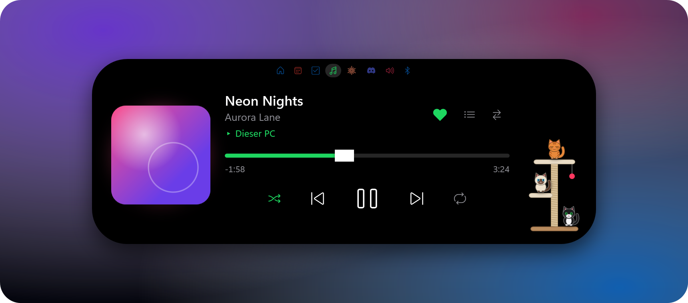
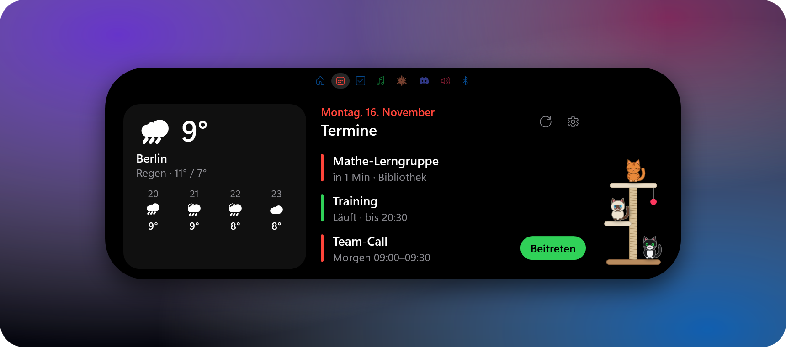
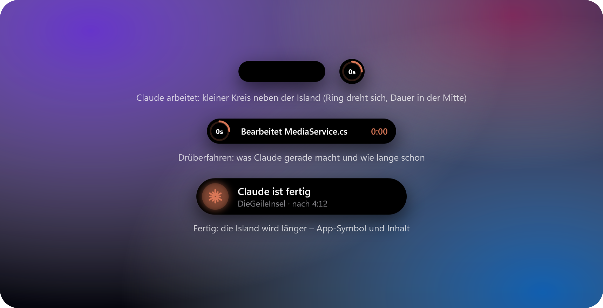

  

  
  
  

  Die schwarze Pille vom iPhone – oben auf deinem Bildschirm. Sie wächst und schrumpft mit Federanimationen,
  zeigt Live-Aktivitäten und lässt sich antippen, wischen und frei verschieben.

---

## ✨ Highlights

### 🆕 Neu in 1.1

<table>
<tr>
<td width="50%"> <b>Lichtring</b> – läuft einmal komplett um die Island, egal wie groß sie gerade wird.</td>
<td width="50%"> <b>Claude-Limits</b> – 5-Stunden- und Wochen-Limit, Warnung bei 80 % und 95 %.</td>
</tr>
<tr>
<td colspan="2"> <b>Maus & Tastatur</b> – Akku von Logitech-Geräten (Lightspeed, Bolt, Unifying, Bluetooth), ganz ohne G HUB. Meldet sich nur, wenn der Akku knapp wird.</td>
</tr>
</table>

- **Obsidian:** Text, Links und Dateien auf die Island ziehen – landen in deiner Inbox (oder Tagesnotiz).
- **Mehrere KIs:** Gemini, ChatGPT, Grok, Claude, Mistral, DeepSeek, OpenRouter.
- **Anrufe annehmen** (WhatsApp, Teams, Discord) direkt aus der Island, **App-Logo** bei jeder Mitteilung.
- **Claude diktieren** per Windows-Spracheingabe, **Katzen-Laune** nach Tageszeit und Wetter, **Suche** in den Einstellungen.
- Island bleibt nach dem Einschalten der Monitore in der Mitte.

### 🎵 Player für Spotify und alle anderen Medien
Großes Cover mit Farb-Leuchten, Spulen, Zufall, Wiederholen. Das Cover schrumpft beim Pausieren, beim Songwechsel gleitet der Titel herein.
Mit dem **Player-Wechsler** springst du zwischen Spotify, YouTube im Browser, VLC & Co.

### 📅 Heute: Wetter + Kalender auf einen Blick
Links das Wetter (Open-Meteo, ohne Konto), rechts deine nächsten Termine – mit „Beitreten“ für Online-Meetings.

### ✳️ Claude Code live verfolgen
Ein kleiner Kreis neben der Island zeigt, dass Claude arbeitet und wie lange schon. Drüberfahren zeigt, was Claude gerade tut.
Ist Claude fertig, wird die Island länger und meldet es mit Logo.

### 🎬 Animationen „App im Vordergrund“
Kopieren, Timer, Nachrichten, Downloads: Die Island streckt sich und zeigt groß das Symbol der App mit dem Inhalt daneben.
Pro Ereignis wählbar: **App · Leuchten · Hüpfen · Beides · Aus** – mit eingebautem Animations-Tester.

### 🐱 Katzen!
Bis zu vier eigene Katzen – Fell, Augen, Muster, Zubehör, Größe und Charakter. Sie blinzeln, schnurren beim Streicheln
und sitzen in der großen Island auf ihrem Kratzbaum. Ganz oben wird geschlafen.

---

## 🧩 Alles, was drin ist

| | |
|---|---|
| 🎧 **AirPods & Kopfhörer** | Akku, Ohrerkennung, automatisches Umschalten |
| 💬 **Nachrichten** | WhatsApp, Discord & Co. – direkt aus der Island antworten |
| 🎙️ **Discord** | Sprachkanal mit Teilnehmern, Stumm/Ton aus, Stream beenden |
| 🎮 **Spiele-Downloads** | Steam & Epic mit Fortschritt und Restzeit |
| ⬇️ **Downloads** | Browser-Downloads live, fertig → antippen öffnet |
| 📋 **Zwischenablage** | Verlauf der letzten 25 Einträge (nur im Arbeitsspeicher) |
| ⏱️ **Timer & Pomodoro** | Countdown in der Pille, Animation wenn fertig |
| 🤖 **KI** | Chat mit Gemini, ChatGPT, Grok, Claude | 🤖 **KI** | Gemini-Chat und Texterkennung vom Bildschirm | Co., Texterkennung vom Bildschirm |
| 🖱️ **Logitech** | Akku von Maus & Tastatur, Warnung wenn er knapp wird |
| 🟣 **Obsidian** | Auf die Island ziehen → landet in deiner Inbox |
| 🖥️ **Mehrere Bildschirme** | Frei verschiebbar, auch auf den zweiten Monitor |

## 🚀 Installation

1. Unter **[Releases](../../releases)** die `DynamicIsland.exe` herunterladen *(oder selbst bauen, siehe unten)*.
2. Starten – die Island erscheint oben in der Mitte.
3. *Rechtsklick → Einstellungen → Mit Windows starten* für Autostart.

### Selbst bauen
Voraussetzung: [.NET 8 SDK](https://dotnet.microsoft.com/download)
- **`Starten.bat`** – baut und startet die App
- **`Als-EXE-bauen.bat`** – erzeugt eine einzelne `DynamicIsland.exe` im Ordner `Fertige App`

## 🖱️ Bedienung

| Geste | Was passiert |
|---|---|
| **Antippen** | Island entfalten · nochmal: Übersicht |
| **Gedrückt halten** | Direkt zur Übersicht |
| **Seitlich wischen / Mausrad** | Seiten wechseln (Vorschau der Nachbarseite) |
| **Rechte Maustaste ziehen** | Island verschieben (rastet nur in der Mitte ein) |
| **Rechtsklick** | Menü mit allen Funktionen |

## 🔒 Datenschutz
Alles läuft lokal. Einstellungen liegen in `%APPDATA%\DynamicIsland`, Zugangsdaten sind mit Windows verschlüsselt.
Die Claude-Anzeige spricht nur mit `localhost`. Fürs Wetter wird nur der Ort an Open-Meteo übertragen.
