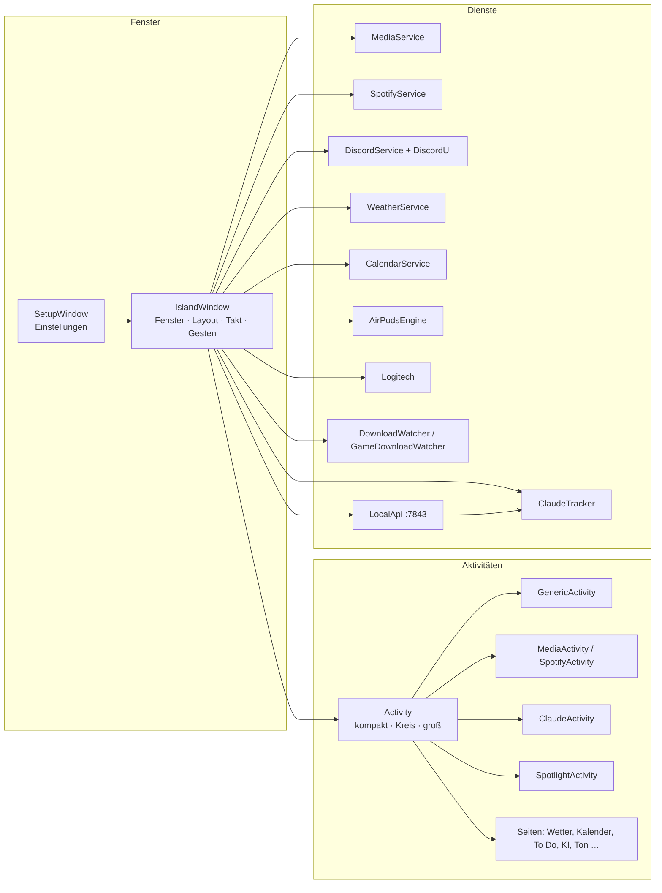

# Spezifikation – Die Geile Insel

- **Produkt:** Dynamic Island für den Windows-Desktop
- **Version:** 1.5.0
- **Stand:** 24.11.2026
- **Änderungen je Version:** [CHANGELOG.md](CHANGELOG.md)
- **Sprache der App:** Deutsch
- **Plattform:** Windows 10 (19041+) und Windows 11, x64

---

## 1. Überblick

- Schwarze Pille oben am Bildschirm, nach dem Vorbild der iPhone-Dynamic-Island
- Wächst und schrumpft mit Federanimationen
- Zeigt Live-Aktivitäten: Musik, Timer, Claude Code, Downloads, Anrufe
- Blendet Hinweise ein: Nachrichten, Fertig-Meldungen, Geräte, Termine
- Aufgeklappt: große Island mit wischbaren Seiten (Übersicht, Player, Wetter, Kalender, To Do, KI …)

### Ziele

- **Unaufdringlich:** nur sichtbar bei Hinweisen oder wenn der Nutzer sie hervorholt
- **Apple-Gefühl:** Federanimationen, Liquid-Glass-Regler, ruhige Typografie
- **Lokal:** keine eigene Cloud, externe Dienste nur nach Einrichtung durch den Nutzer
- **Persönlich:** Katzen, Farben, Größe, Schrift, Seiten und Animationen frei einstellbar

---

## 2. Technik

- **Sprache / UI:** C#, WPF (`UseWPF`), keine XAML-Dateien – Oberfläche komplett im Code
- **Laufzeit:** .NET 8 (`net8.0-windows10.0.19041.0`), `RollForward=Major` (läuft auch mit .NET 9/10)
- **Windows-APIs:**
  - WinRT: Medien-Sitzungen, Bluetooth, Benachrichtigungen, Geolocation, OCR
  - Win32 per P/Invoke
  - UI Automation (Discord-Stream, Anruf-Knöpfe)
  - HID (Logitech HID++ 2.0)
- **Einzelinstanz:** Mutex `DynamicIsland-Einzelinstanz`, zweiter Start zeigt Hinweis und beendet sich
- **Datenordner:** `%APPDATA%\DynamicIsland`
  - `einstellungen.json` (+ `.bak`, `.bad`)
  - `fehler.log`
  - `Katzen\` (Fotos)
- **Fehler:** globale Handler, Ausnahmen nach `fehler.log`, gleiche Meldung nur einmal
- **Takt:** `DispatcherTimer`, 50 ms (20×/s) – Aktivitäten, Auto-Ausblenden, Abfragen

---

## 3. Architektur



### 3.1 Hauptbausteine

- **`IslandWindow`**
  - transparentes, randloses Topmost-Fenster (1000×580), aktiviert sich nicht
  - enthält Pille, Kreis („Bubble“), Kamera-/Mikro-Punkte, Katzen-Panel
  - verwaltet Aktivitätsliste, Auswahl (`Relayout`), Größen-/Inhaltsanimation
  - Gesten, Auto-Ausblenden, Menüs, Hotkeys, lokale API
- **`Activity`** – Basisklasse jeder Anzeige
  - Ansichten: **kompakt** (Pille), **minimal** (Kreis), **erweitert** (große Island)
  - Eigenschaften: `Priority`, `IsAlert`, `ExpiresAt`, `Finished`, `CanExpand`, `PreferBubble`, `BubbleHoverWidth`, `IconFactory`
- **`GenericActivity`** – universell (Symbol, Texte, Fortschritt, Knöpfe, Banner) für Hinweise, Demos, API
- **`SetupWindow`** – Einstellungen im Stil der Apple-Systemeinstellungen (Seitenleiste + Karten, Suche)
- **`Ui`** – Farben, Schriften, Bausteine (Text, Glyph, RoundButton, Bar, Row3 …), `SpringEase`, `TextBoost`
- **`LiquidGlass`** – Pixel-Shader für gläserne Reglerknöpfe (abschaltbar: „Flach“)
- **`Settings`** – JSON-Einstellungen mit Migrationen (`LayoutVersion`, `PagesVersion`, `TilesVersion`, `FeatureVersion`)

### 3.2 Anzeige-Auswahl (`Relayout`)

1. Abgelaufene (`ExpiresAt`) und beendete Aktivitäten entfernen (Hinweise bleiben, solange die Maus darauf liegt)
2. **Hinweis** = neueste Aktivität mit `IsAlert`; **Live** = übrige, nach `Priority` (angepinnte zuerst)
3. `PreferBubble` (Claude) wohnt bevorzugt im Kreis, außer angepinnt
4. Hauptpille = Hinweis oder wichtigste Live-Aktivität; Kreis = Bubble- oder zweitwichtigste Aktivität
5. Aufgeklappte Seite: Pille zeigt die große Island (einheitliche Seitengröße)

---

## 4. Darstellung

### 4.1 Zustände

- **Leerlauf:** Uhrzeit links, Wetter rechts (farbiges Symbol, abschaltbar); ohne Wetter Akku oder Datum; alternativ dünner Strich
- **Kompakt:** Symbol links, Inhalt rechts (z. B. Cover + Visualizer, Timer-Ring + Restzeit)
- **Kreis:** zweite Aktivität als 36-px-Kreis neben der Pille; Claude mit Ring + Dauer, beim Drüberfahren breit mit Text
- **Banner:** Titel + Untertitel (Nachrichten, Geräte, Termine); „klein“: 50 px hoch, max. 360 px breit
- **Spotlight („App im Vordergrund“):** App-Symbol im leuchtenden Kreis, Inhalt daneben; klein (eine Zeile) oder groß (zwei Zeilen)
- **Große Island:** Seiten mit Seitensymbolen oben, optional Katzen-Kratzbaum rechts

### 4.2 Größe

- Grundmaß der großen Island: 420×232
- `PageScale` (0,7–1): verkleinert die große Island
- `PageWide` (1–1,45): verbreitert sie, Inhalt bekommt mehr Breite, keine Verzerrung
- `Scale`: skaliert alles
- `PageFont`: Schrift der Seiten, unabhängig von der Island-Größe (siehe 7.2)

### 4.3 Mitte und Schatten

- **Genau in der Mitte** (`IslandFixedCenter`, Standard an): unsichtbarer Platzhalter links, so breit wie Kreis + Kamera-/Mikro-Punkte rechts – Pille rutscht nicht zur Seite
- Aus: Pille und Kreis werden zusammen zentriert
- Schatten auf eigener Fläche hinter der Pille, damit Wischen und Animationen flüssig bleiben

---

## 5. Bedienung

### 5.1 Gesten

- **Antippen:** Aktivität aufklappen · erneut: Übersicht · erneut: zu
- **Gedrückt halten:** direkt zur Übersicht
- **Seitlich wischen (groß):** Seite wechseln, im Kreis (nach der letzten die erste); Nachbarseite schaut beim Ziehen herein
- **Seitlich wischen (klein):** links = Aktivität ausblenden · rechts = zurückholen
- **Mausrad (groß):** Seite wechseln; Listen scrollen zuerst, Regler behalten das Rad
- **Seitensymbol antippen:** direkt zur Seite
- **Rechte Maustaste ziehen:** Island verschieben, auch auf andere Bildschirme; rastet nur in der Mitte ein
- **Rechtsklick:** Menü mit allen Funktionen
- **Klick daneben:** große Island klappt zu
- **Maus an den oberen Rand:** versteckte Island kommt hervor
- **Kreis antippen:** Pille und Kreis tauschen (anpinnen)
- **Antippen bis 6 s nach „Claude ist fertig“:** holt die gerade verschwundene Meldung für 30 s zurück

### 5.2 Tastenkürzel (global)

- `Strg + Alt + Leertaste` – Übersicht
- `Strg + Alt + K` – Kurzbefehle
- `Strg + Alt + D` – Downloads
- `Strg + Alt + M` – Mikro an/aus (in einer Teams-Besprechung Teams, sonst Discord)
- `Strg + Alt + V` – Zwischenablage-Verlauf
- `Strg + Alt + A` – App-Wechsler
- `Strg + Alt + G` – KI-Chat
- `Strg + Alt + T` – Text vom Bildschirm erkennen (OCR)
- `Strg + Alt + N` – neue Aufgabe (To Do)

---

## 6. Ein- und Ausblenden

### 6.1 Auto-Ausblenden

- Island fährt nach `HideDelay` (Standard 3 s) komplett nach oben weg
- Ausnahmen:
  - ein Hinweis läuft (Nachricht, Fertig-Meldung, Spotlight, Sprachmemo)
  - Maus auf der Island oder am oberen Rand, Taste gedrückt, Menü offen
  - Einstellungsfenster ist aktiv (im Hintergrund nicht)
  - große Island aufgeklappt – klappt nach 6 s ohne Maus von selbst zu
- Nur Hinweise und der Nutzer holen die Island hervor; laufende Aktivitäten (Claude, Timer, Musik) nicht
- Vollbild (Spiel/Video) auf demselben Bildschirm: Island blendet sich aus (abschaltbar)
- Hängende Zustände (verpasstes MouseLeave, Menü ohne „Closed“) werden alle 0,5 s bereinigt

### 6.2 Mehrere Hinweise

- Laufender Hinweis: neuer Hinweis wartet in einer Schlange, danach volle Anzeigezeit
- Wichtigerer Hinweis unterbricht weniger wichtigen; der unterbrochene kehrt mit Restzeit (min. 2 s) zurück
- Gleicher Typ ersetzt sich (z. B. zweimal „Kopiert“); Einträge älter als 90 s verfallen
- Kurze Systemanzeigen (Lautstärke, Feststelltaste, Discord-Mikro) laufen außerhalb der Schlange
- Prioritätsliste (einstellbar): Anrufe · Nachrichten · Claude · Termine · Timer · Downloads & Spiele · Geräte · Kopieren · Sonstiges

---

## 7. Seiten der großen Island

### 7.1 Seiten

- Reihenfolge und Auswahl: Einstellungen → Seiten & Widgets
- Laufende Aktivitäten (Timer, Claude, Discord …) automatisch hinter Übersicht/Player
- Schlüssel:
  - `dashboard` – Übersicht im Sperrbildschirm-Stil: Datum über großer Uhr, rechts Player (wenn Musik läuft) oder Wetter, unten runde Knöpfe gleichmäßig über die Breite
  - `weather` – Wetter: jetzt und die Wochentage; Tag antippen = Stunden dieses Tages (siehe 8.2)
  - `calendar` – Kalender: nächste Termine, optional Wetter links
  - `todo` – Microsoft To Do
  - `note` – Notiz: ein Zettel zum schnellen Aufschreiben, speichert beim Tippen (`notiz.txt` im Datenordner), Kopieren und Leeren im Kopf
  - `worldclock` – Weltuhr: bis zu 6 Städte mit Uhrzeit, Zeitunterschied und kleinem Ziffernblatt (hell am Tag, dunkel in der Nacht); öffnet sich auch beim Antippen der Uhr in der Übersicht
  - `ai` – KI-Chat, Rechner, Text-Drop-Zone
  - `player` – Spotify- oder Medien-Player
  - `bluetooth` – Kopfhörer- oder Bluetooth-Seite (AirPods-Seite nur mit eingeschalteten AirPods-Funktionen)
  - `sound` – Lautstärke, Mikrofon
  - `w:<id>` – eigene Widget-Seite (bis 4 Widgets)
  - `downloads`, `clipboard`, `messages`, `apps`, `brightness`, `shortcuts` – Panels

### 7.2 Schrift und Stil

- **Schrift** (`PageFont`): Normal 1,0 · Groß 1,2 (Standard) · Größer 1,4 · Sehr groß 1,6
  - wirkt beim Aufbau einer Seite (`Ui.TextBoost`), Symbole wachsen zu 60 % mit
  - Island bleibt gleich groß
- **Stil** (`PageStyle`):
  - `clean` (aufgeräumt, Standard): weniger Einzelheiten, größer
  - `full` (ausführlich): alle Details
- **Pro Seite** (`PageLooks[key] = { Font, Style }`): Knopf „Aa“ in Seiten & Widgets, leer = wie alle
- **Aufgeräumt** im Detail:
  - Wetter: ohne Gefühlt/Wind/Feuchte, ohne Regen-%, 6 statt 7 Tage, etwas größer
  - Kalender: größere Termine, max. 3
  - Bluetooth: größere Kacheln, ohne Linkzeile

### 7.3 Einheitliches Design

- Alle Seiten im Stil der Übersicht: gleicher Rand (`Ui.PageMargin`), gedämpfte Schrift (`Ui.Soft`)
- Kopf (`Ui.PageHead`): optionale kleine Zeile über dem Titel (19 pt), rechts runde Knöpfe (`Ui.CircleButton`) statt Text-Links
- Listen (Downloads, Zwischenablage) als gruppierte Karte (`Ui.Group`)

### 7.4 Navigation

- **Seitensymbole** oben: Symbol 13 px, Feld 21 px hoch; farbig oder alle weiß
- Claude, Discord und Teams mit eigenen gezeichneten Logos
- **Claude-Logo** (`Logos.Claude`): gefüllte, spitz zulaufende Strahlen (11, unregelmäßig) um einen Kern, in der Claude-Farbe
- **Wisch-Vorschau:** letzte Fassung jeder Seite zwischengespeichert, beim Ziehen daneben gezeigt; unbekannte Seiten als Symbol + Name
- Beim Loslassen gleitet die neue Seite nahtlos weiter (Federanimation, kein Ausblenden)

---

## 8. Funktionen

### 8.1 Musik

- **MediaService:** Windows-Mediensitzungen (jede App, die Windows-Medien meldet)
  - Play/Pause, Spulen, Zufall, Wiederholen
  - Akzentfarbe aus dem Cover
  - **Musikdienste erkannt** (`Provider`, mit Markenfarbe `ProviderColor`): YouTube Music, YouTube, SoundCloud, Apple Music, Deezer, TIDAL, Amazon Music, Qobuz, Bandcamp, Mixcloud, Audiomack, Pandora, Napster, TuneIn, Plexamp, VLC, foobar2000, MusicBee, AIMP, Winamp
  - Erkennung: Desktop-App am App-Namen; Browser-Tab am Fenstertitel, in dem der Songtitel steht („YouTube Music“ vor „YouTube“)
  - **Webseiten im Browser** (`MediaService.Site`, `SiteLogo`): Adresse per UI Automation aus der Adressleiste des Fensters mit dem Medientitel
    - Name der Seite statt Browsername („In Twitch öffnen“); bekannte Dienste in ihrer Schreibweise
    - Ohne echtes Cover (Bild mit durchsichtigen Stellen = Browser-Logo) zeigt der Player das Logo der Seite: Icons aus dem HTML (größtes zuerst), sonst `apple-touch-icon.png`, sonst `favicon.ico`, sonst die Hauptdomain; mittig auf dunkler Fläche in der Logofarbe
    - Logos werden direkt von der Seite geladen (kein fremder Dienst) und pro Domain im Arbeitsspeicher gehalten
  - Anzeige: Quellenname im Player („In Deezer öffnen“), Player-Wechsler mit schönen App-Namen (auch Opera, Brave)
- **SpotifyService:** Spotify Web API (OAuth, Redirect `http://127.0.0.1:8898/callback`)
  - Gefällt mir, Geräte, Playlists, Lautstärke (Steuern nur mit Premium)
- **Player-Wechsler:** alle Quellen mit Status und Titel; Auswahl angeheftet bis „Automatisch“
- **Player-Design (`PlayerUi`):**
  - Cover 124 px mit Farbleuchten links; Titel, Künstler, Gerät, Spulleiste, Steuerung rechts
  - Cover schrumpft bei Pause (0,88), Play-Knopf federt
  - Songwechsel: altes Cover gleitet hinaus, neues aus der anderen Seite herein (Richtung nach Weiter/Zurück), Titel gleitet mit Unschärfe herein, Leuchten blitzt kurz auf
  - Kommt der Titel vor dem Cover (Windows-Medien), wird der Cover-Wechsel nachgeholt, sobald es da ist (max. 3 s)
  - Farbe des Leuchtens gleitet zum neuen Cover über; Leuchten atmet langsam
  - Weiter/Zurück-Knopf stupst in seine Richtung; kleine Island: Cover federt auf, Titel rollt von unten herein
  - Bei „Animationen aus“ in Windows ohne Bewegung
- „Zurück zum Player“ öffnet den Player immer (auch pausiert, 2 Minuten erreichbar)

### 8.2 Wetter

- Quelle: Open-Meteo (ohne Konto), alle 15 min, 7 Tage Vorhersage (`AllHours` = alle Stunden, `Hours` = nächste 12)
- Ort: aus den Einstellungen oder – nur auf Wunsch – Windows-Standort (15 s Zeitlimit)
- **Wetter-Seite (Übersicht):**
  - Kopf: großes Symbol, Temperatur, Ort, Beschreibung · Max/Min (ausführlich: Gefühlt, Wind, Feuchte)
  - Wochentage als Karte: „Heute“, „Mi“ … mit Symbol, Höchstwert (weiß) und Tiefstwert (grau); aufgeräumt 6, ausführlich 7 Tage
  - keine Stundenleiste – Stunden nur auf Knopfdruck
- **Tagesansicht** (Tag antippen):
  - Kopf: Zurück-Knopf, Tag („Freitag, 27. November“), Beschreibung, Max/Min, Regen ab 20 %
  - heute: ab jetzt jede Stunde (max. 12, spät abends mit morgen aufgefüllt); andere Tage: alle 2 Stunden von 0 bis 22 Uhr
  - Raster 6 × 2: Uhrzeit, Symbol, Temperatur (ausführlich: Regen ab 30 %)
  - irgendwo auf die Island tippen → zurück zur Übersicht
- **Farbige Symbole** (`WeatherIcon`, Vektor, 24×24):
  - Sonne gelb, Mond hell, Wolken weiß/grau, Regen blau, Eisregen hellblau, Schnee hellblau, Gewitter mit gelbem Blitz, Nebel grau
  - in Leerlauf-Pille, Wetter-Seite, Kalender-Seite und Widget
- **Einstellungen:** eigene Seite an/aus, Wetter in der kleinen Ansicht an/aus
- Temperaturen ohne „-0°“

### 8.3 Kalender

- iCal-Adressen (Google, Outlook, iCloud), verschlüsselt gespeichert, alle 10 min geladen
- Erinnerung X Minuten vorher, Meldung bei Beginn, Ansage per Sprachausgabe
- „Beitreten“ bei Online-Meetings, Countdown-Aktivität
- Ladefehler (z. B. 401) werden auf der Seite angezeigt statt „Wird geladen …“
- **Einstellungen:** eigene Seite an/aus, Wetter links auf der Kalender-Seite (`CalendarWithWeather`)
- Migration v8 trennt die frühere Seite „Heute“ in Wetter und Kalender

### 8.4 Claude Code

- **Hooks** in `%USERPROFILE%\.claude\settings.json`
  - Ereignisse: UserPromptSubmit, PreToolUse, PostToolUse, Notification, Stop, SessionEnd, PreCompact
  - senden das Hook-JSON per `curl` asynchron an `http://localhost:7843/claude`
- **ClaudeTracker:** eine `ClaudeActivity` pro Sitzung
  - Zustände: arbeitet (Ring in der Claude-Farbe), wartet (gelb, „!“), fertig (Haken in der Claude-Farbe)
  - **Claude-Farbe** = eingestellte Farbe von „Claude ist fertig“ (Standard Claude-Orange): Kreis, Ring, Laufzeit, Logo, Seitensymbol
  - Pille zeigt beim Arbeiten das Claude-Logo statt eines Zeichens; auch Limit-Warnung, Limits-Seite und Kachel „Claude-Limits“
  - Werkzeuge als deutsche Sätze („Bearbeitet Cats.cs“, „Sucht …“, „Denkt nach …“)
- **„Claude ist fertig“:**
  - Kreis gleitet hinter die Pille und verschmilzt mit ihr (440 ms)
  - Haken gleitet an den rechten Rand der Meldung, mit 8 px Luft zum Rand (`ReserveRight` 26)
  - Meldung 4,5 s; endet sie, verschwindet auch der fertige Kreis und die Island fährt hoch
  - Antippen innerhalb von 6 s danach holt „Claude ist fertig“ für 30 s zurück (angepinnt)
  - Titel, Logo und Haken in der Ereignisfarbe
- **Laufzeit:**
  - zählt ab der Nachricht des Nutzers
  - nach Neustart der Island oder Fortsetzung ohne neue Nachricht: Beginn aus dem letzten echten Nachrichten-Zeitstempel im Verlauf (`transcript_path`, UTC → Ortszeit, max. 12 h)
  - „Werkzeug startet“ bis 4 s nach „fertig“ ignoriert, später = neue Aufgabe
  - `/compact` legt keinen neuen Kreis an
- **Kreis verschwindet ohne „Stop“:**
  - Abbruch mit Esc (Vermerk `[Request interrupted by user]` im Verlauf)
  - kein `claude`-Prozess mehr
  - Stille: 6 min, 12 min bei laufendem Werkzeug, 30 min beim Warten
- Einrichtung per Knopf in den Einstellungen; Seite „Claude“ nur, wenn Claude installiert ist

### 8.5 Claude: Limits und Spracheingabe

- **Nutzungs-Limits** (Pro/Max) nur von Claude Code im Terminal (die Claude-App sendet keine)
  - nur echte Werte, höchstens 12 h alt
  - `used_percentage` auf 0–100 begrenzt; `resets_at` als Unix-Sekunden, Millisekunden oder ISO
  - „Verbinden“ trägt eine Statuszeile ein (nur wenn keine eigene existiert), die das JSON an `/claude-limits` sendet
  - Anzeige: Details der Claude-Pille, Kachel „Claude-Limits“, Einstellungen → Claude
  - Warnung bei 80 % und 95 % je Fenster (`ClaudeLimitWarn`), je Stufe einmal
- **Claude diktieren** (Kachel): holt das Claude-Fenster nach vorn, startet Windows-Spracheingabe (Win+H)

### 8.6 Nachrichten, Antworten, Anrufe

- Windows-Mitteilungen werden gespiegelt, Farbe von „Neue Nachricht“ oder eigene Farbe der App (`AppColors`, siehe 8.14)
- **Nachrichten-Verlauf** (`MessagesActivity`, `MessageHistory`):
  - letzte 30 Nachrichten nur im Arbeitsspeicher (beim Beenden weg)
  - Zeile: App-Logo, Absender, Text, Uhrzeit, App-Name in App-Farbe; Liste scrollt
  - Antippen öffnet die App; „Leeren“ im Kopf
  - erreichbar: Rechtsklick → „Nachrichten“, Kachel „Nachrichten“, `/page?key=messages`
- **App-Logo** aus Windows (`AppIcons`, einmal pro App geladen); Discord ohne Logo: Discord-Zeichen; Teams in Teams-Lila
- **Claude-App-Mitteilungen:** nicht als Chat; bei frischem Hook-Signal (≤ 45 s) gar nicht, sonst als Claude-Meldung
- **Antworten:**
  - Standard: Knopf nur bei Chat-Apps (WhatsApp, Discord, Teams, Telegram, Signal, Messenger, Slack, Instagram, Skype, Threema, Element); Smartphone-Link und andere Apps ohne Knopf
  - pro App einstellbar (`ReplyApps`, Einstellungen → Hinweise → „Antworten-Knopf pro App“; gespeichert werden nur Abweichungen vom Standard)
  - Eingabefeld in der Island → App aktivieren, Chat öffnen (WhatsApp: Suche; Discord-DM: Direktlink; Server-Kanal: Schnellsuche), Text einfügen
  - WhatsApp und Discord-DMs: optional direkt absenden (`ReplyAutoSend`)
  - **Unsichtbar senden** (`BackgroundReply`, `ReplyBackground`, Standard an): zuerst per UI Automation versuchen, ohne das Fenster nach vorn zu holen
    - nur wenn: App-Fenster offen (nicht minimiert), Chat mit dem Absender offen (Name über dem Eingabefeld, nicht in der Chat-Liste), Eingabefeld leer, Senden-Knopf vorhanden
    - gesendet gilt nur, wenn das Eingabefeld danach leer ist; sonst Text wieder entfernen und normaler Weg
    - geht nicht bei Apps, die ihren Inhalt nicht an die Bedienhilfen geben: WhatsApp (WebView2) und Discord (Electron) zeigen nur die Fensterknöpfe; Discord hat zudem keinen Senden-Knopf
  - **Zurück zum vorherigen Fenster** (`ReplyReturn`, Standard an): nach dem Senden springt die Island in das Fenster zurück, in dem du vorher warst (`ForceForeground` mit kurz gekoppelter Eingabe); war die App vorher minimiert oder nicht offen, wird sie wieder minimiert. Nur eingefügt (nicht gesendet): App bleibt vorne zum Prüfen
- **Anrufe** (WhatsApp, Teams, Discord ohne RPC, Skype, Telegram, Signal):
  - grüner/roter Knopf im Anruf-Banner
  - `CallUi` sucht per UI Automation „Annehmen“/„Ablehnen“ in der Windows-Mitteilung, dann in den App-Fenstern (Audio vor Video)
  - nicht gefunden: App öffnen + Hinweis

### 8.7 Discord

- RPC über Named Pipe (`discord-ipc-N`) mit eigener Anwendung (Client-ID/Secret)
- Seite im Discord-Look:
  - Kopf: Discord-Logo, grünes „Sprachverbindung“ / „Anruf verbunden“ mit Dauer, Kanalname
  - Steuerung rechts im Kopf: Mikro, Ton aus, Stream beenden (dunkelgraue Kreise, rot wenn aus), Auflegen als rote Kapsel
  - Teilnehmer als dunkle Kacheln (Avatar mittig, Name unten links in dunkler Kapsel), rotes Abzeichen bei stumm/Ton aus
  - Sprechen: groß nur grüner Rahmen um die Kachel, klein (Pille) nur grüner Ring ums Profilbild
  - Kacheln werden mit mehr Teilnehmern kleiner (bis 4 / 8 / mehr)

### 8.7a Microsoft Teams

- Lokale Teams-„Drittanbieter-App-API“ (neues Teams), WebSocket `ws://127.0.0.1:8124`, Protokoll 2.0.0
- Einrichten: in Teams Einstellungen → Datenschutz → „Drittanbieter-App-API“ aktivieren, in der Island „Mit Teams verbinden“
- Kopplung: nur während einer Besprechung; die Island bietet einmal „Mit Teams koppeln“ an (oder Einstellungen → Teams → „Koppeln“), Teams fragt „Zulassen“
- Token von Teams (`tokenRefresh`) wird lokal gespeichert, danach Verbindung ohne Nachfrage; „Kopplung aufheben“ löscht ihn
- Neuer Verbindungsversuch alle 5 s, solange Teams nicht läuft
- Sichtbar nur, wenn gekoppelt **und** in einer Besprechung (`isInMeeting`), verschwindet beim Verlassen
- Seite im Teams-Look:
  - Kopf: Teams-Logo, „Besprechung“ mit Dauer, rote „REC“-Kapsel bei Aufnahme, „Du teilst“ beim Teilen, rote „Verlassen“-Taste
  - eigene Kachel „Du“: lila Rahmen bei offenem Mikro, Stumm-Symbol, gelbe Hand
  - Leiste wie in Teams (Symbol über Beschriftung): Kamera, Mikro, Hand, Chat, Unschärfe – aktiv lila, Mikro aus rot
  - Reaktionen: Gefällt mir, Herz, Lachen; Kapsel „Neue Nachrichten“ öffnet den Chat
  - Knöpfe ausgegraut, wenn Teams die Aktion nicht erlaubt (`meetingPermissions`)
- Pille: Logo, „Besprechung“ / „Hand gehoben“ / „Du teilst“, roter Punkt bei Aufnahme, Mikro-Status, Dauer
- Rechtsklick-Menü „Teams stummschalten“; `Strg + Alt + M` schaltet das Teams-Mikro
- Teilnehmerliste liefert die Schnittstelle nicht

### 8.8 Geräte

- **Bluetooth-Seite:** runder Schalter (blau = an), Status, Zahnrad; Geräte als Kacheln in zwei Spalten
- **Kopfhörer-Seite:** Akku-Ring, Name + Status, „Ton läuft hier“ / „Ton hierher holen“, Lautstärke
- **Kopfhörer als Standard:** alle Kopfhörer (auch AirPods) laufen als normale Kopfhörer; Einstellungsseite „Kopfhörer“ zeigt die verbundenen
- **AirPods-Funktionen** (`AirPodsEnabled`, Standard aus; Migration `FeatureVersion` 1 schaltet sie einmalig aus):
  - nur nach Einschalten (Einstellungen → Kopfhörer → „AirPods-Funktionen (mit WPods)“)
  - BLE: Akku, Case, Ohrerkennung
  - Auto-Pause/-Weiter, Auto-Umschalten, AAP über WPods (ANC/Transparenz)
  - Case-Popup nur bei wirklich verbundenen eigenen AirPods (bis 7,5 s gewartet), nicht bei großer Island
  - AirPods verbunden (Audiogerät erscheint, nicht in den ersten 15 s nach dem Start) → Animation „Gerät verbunden“
- **Bluetooth/USB/Controller:** Meldung mit Akku-Ring, pro Gerät max. alle 3 h und nur nach ≥ 20 min Abwesenheit
  - Animation „Gerät verbunden“ in der Gerätefarbe (`DeviceColors`), Symbol in der Gerätefarbe
  - **Licht nach Akkustand** (`BatteryGlow`, Standard aus): rot unter `BatteryLow` (10–40 %, Standard 20), grün ab `BatteryHigh` (50–90 %, Standard 80), dazwischen gelb; färbt Licht und Akku-Ring, geht vor der Gerätefarbe; nur bei bekanntem Akku (nicht USB-Speicher)
  - USB-Stick = Gerät (Name = Laufwerksname), Abziehen nur kurz „Entfernt“
  - Migration: „Gerät verbunden“ nur mit „App“ → „App + Licht“ (Geräte haben keine große App-Ansicht, daher sonst kein Licht)
- **Logitech** (`Logitech.cs`, `LogitechEnabled`):
  - HID++ 2.0 direkt über Windows, ohne G HUB/Options+
  - Empfänger (Lightspeed, Bolt, Unifying; Geräte 1–6, FF00/0002) und Bluetooth (FF43/0202)
  - Funktionen 0x1004, 0x1000, 0x1001 (Spannung → %)
  - Abfrage alle 2 min im Hintergrund
  - schlafendes Gerät: letzter Wert bis 24 h mit „Ruhezustand“
  - Warnung nur unter `LogitechWarnAt` (10/15/20/30 %, Standard 15 %) und bei 5 %, je einmal bis geladen wird
  - Anzeige: Bluetooth-Seite (zuerst), Kachel „Maus & Tastatur“, API `/logitech`

### 8.9 Downloads

- Browser-Downloads über Temp-Dateien (`.crdownload`, `.part` …) mit Größe und Geschwindigkeit
- Steam (`appmanifest_*.acf`): Prozent, Geschwindigkeit, Restzeit
- Epic: ohne Prozent

### 8.10 Werkzeuge

- **Timer-Auswahl:** drei Drehräder (Std · Min · Sek), Schnellwahl (1–30 min, Pomodoro), letzte Dauer gemerkt
- **Laufender Timer:** Ring leert sich (Pille, Kreis, groß), „Endet um …“, +1/+5/Pause/Beenden
- Pomodoro (25/5/15), Stoppuhr mit Runden, Sprachmemos
- Notiz: Seite `note` und Kachel „Notiz“, antippen und lostippen, Esc beendet
- Zwischenablage-Verlauf: 25 Einträge, nur im Arbeitsspeicher, Passwörter verdeckt
- App-Wechsler, Helligkeit (DDC/CI + intern), Kurzbefehle
- Texterkennung (OCR) per Mittelklick oder Hotkey

### 8.11 KI-Anbieter

- Gemini, ChatGPT (OpenAI), Grok (xAI), Claude (Anthropic), Mistral, DeepSeek, OpenRouter
- je Anbieter eigener Schlüssel (DPAPI) und Modell (leer = Standard)
- OpenAI-kompatibel über `chat/completions`, Claude über `messages`
- unbekanntes Modell: passendes aus der Modell-Liste des Anbieters wählen und speichern
- Chat, Drop-Zone und Texterkennung zeigen den Namen des Anbieters

### 8.12 Obsidian

- Text, Links und Dateien auf die Island ziehen → Vault (`Obsidian.cs`)
- **Ziel:**
  - Inbox-Ordner (Standard; automatisch der Ordner mit „Inbox“/„Eingang“): je Text eine neue Notiz mit Frontmatter `erstellt`, `quelle`; Dateien direkt in den Ordner
  - Tagesnotiz (Ordner + Format aus `.obsidian/daily-notes.json`)
  - feste Notiz (`ObsidianNote`, Standard „Eingang“)
  - optional Uhrzeit vor jedem Eintrag
- Vault aus `%APPDATA%\obsidian\obsidian.json` oder selbst gewählt
- Anhänge in den Anhang-Ordner (`attachmentFolderPath`), Bilder/PDF/Audio eingebettet
- Dateien immer nach Obsidian; Text nur, wenn die KI-Drop-Zone aus ist (sonst Karte „In Obsidian“)

### 8.13 Katzen

- Bis zu 4 Katzen: Vorlage (9 Rassen), Fell-/Augenfarbe, Muster, Flauschig, Zubehör, Größe, Charakter, optional Foto
- Blinzeln, Schwanzwedeln, Umschauen, Hüpfen, Schnurren beim Streicheln, Einschlafen
- **Kratzbaum** in der großen Island (Plätze: oben, Mitte links, Boden links/rechts)
  - alle 4–9 s: Sprung auf freien Platz, Einschlafen (12–32 s) oder zu zweit oben schlafen (18–36 s)
  - Streicheln weckt; Verteilung bleibt, nach > 40 s zu neu verteilt
- **Zusammenrollen** (`CatsCurl`): im Schlaf eingerollt, nur gezeichnete Katzen
- **Herumlaufen** (`CatsWalk`): trippeln ab und zu zur Seite und zurück
- **Laune** (`CatsMoodAuto`): Charakter + Tageszeit + Wetter (Sonne verspielt; Regen, Schnee, Gewitter, Hitze, Kälte müde)
- Vorlage wählen setzt eigene Farben/Muster zurück

### 8.14 Animationen

- **Pro Ereignis frei kombinierbar:** App · Licht · Hüpfen (`AnimModes[evt]` = z. B. `app,glow,bounce`, `off` = aus)
  - alte Werte werden gelesen: `appglow` = App + Licht, `both` = Licht + Hüpfen
  - App + Licht/Hüpfen: erst wird die Island länger, nach 320 ms Licht bzw. Hüpfer
  - „App“ ohne große Ansicht (Nachricht, Gerät): allein gewählt = Hüpfer
- **Licht-Effekte**, mehrere gleichzeitig (`GlowStyle` = z. B. `orbit,halo`; pro Ereignis `GlowStyles[evt]`, leer = Standard):
  - Umlauf: Licht läuft einmal um die Island (folgt der Zielgröße)
  - Schein: weicher Schimmer dahinter
  - Glanz: Reflex zieht über die Island
  - Rahmen: Rand leuchtet zweimal
- **Umlauf** (`OrbitLook`, `OrbitEnd`):
  - Komet (Standard): heller Kopf, Schweif aus 12 Lagen, nach hinten weich ausgeblendet; Streifen: gleichmäßig
  - startet oben in der Mitte, Muster = genau ein Umfang (läuft nahtlos über den Anfangspunkt)
  - Weich auslaufen (Standard): 1,3 Runden in 2,1 s, langsam los, bremst am Ende und verglüht dabei
  - Rahmen schließen: eine Runde, danach leuchtet der ganze Rand auf und verblasst sanft (2,6 s)
- **Farben:** pro Ereignis (`AnimColors`), pro App bei Nachrichten (`AppColors`), pro Gerät (`DeviceColors`); Reihenfolge: App/Gerät vor Ereignis vor Standard
  - Apps/Geräte erscheinen nach der ersten Nachricht bzw. Verbindung in der Liste (`SeenApps`, `SeenDevices`, je max. 40) oder werden selbst eingetragen
- **Einstellungsseite:** Kapseln (Mehrfachauswahl) für Licht-Effekte; Bereich „Umlauf“ mit Vorschau; je Ereignis eine Karte (Farbpunkt, Name, Zusammenfassung, Testen, Kapseln „Animation“, bei Licht „Licht“); Listen „Farbe pro App“/„Farbe pro Gerät“; Schnellknöpfe
- **Spotlight-Inhalte:**
  - Claude fertig: Logo · Projekt · Dauer, Haken rechts
  - Timer abgelaufen: Symbol · Uhrzeit
  - Download/Spiel fertig: Datei bzw. Spiel · Größe/Store
  - Kopieren: Symbol · Textanfang
  - Nachricht/Gerät: Banner + Hüpfer
- Katzen hüpfen mit; „Bewegungen reduzieren“ (Windows) schaltet Animationen ab

### 8.15 Hinweise

- **Design** (`AlertSize`): Klein (Standard) · Groß · Mitteilung (iPhone-Stil) · Minimal · Leuchtend
- **Erscheinen** (`AlertMotion`): Schieben (Standard) · Tropfen · Ohne
- Vorschau-Knöpfe für Claude, Gerät, Nachricht
- **Kurz anzeigen:** Lautstärke, Kopieren, Feststelltaste, Geräte, Kamera-/Mikro-Punkte, Downloads
- **Reihenfolge** (`AlertPriority`): oben zuerst, wichtigere unterbrechen

### 8.16 Position und Monitore

- DPI aus dem Fenster statt aus der Hauptbildschirm-Breite
- nach `DisplaySettingsChanged` mehrfach neu platzieren (0,4 / 1,5 / 4 / 9 s), Wächter alle 2 s
- gespeicherte Position bleibt unverändert

---

## 9. Schnittstellen

### 9.1 Lokale API (`http://localhost:7843`, nur dieser PC)

- **`/show`** (GET) – eigene Aktivität anzeigen/aktualisieren
  - Parameter: `id`, `title`, `sub`, `left`, `right`, `detail`, `icon` (Hex-Glyph), `emoji`, `color`, `progress` (0–1), `banner=1`, `width`, `seconds` (als Hinweis), `glow` (orbit/halo/shine/ring, mehrere mit Komma)
  - Beispiel: `/show?id=spiel&title=FCB%202:1%20BVB&right=67'&icon=E7FC`
- **`/hide`** (GET) – Aktivität `id` entfernen
- **`/claude`** (POST) – Claude-Code-Hook-JSON
- **`/claude-limits`** (POST) – Statuszeilen-JSON (Nutzungs-Limits)
- **`/logitech`** (GET) – Akku von Logitech-Maus/-Tastatur zeigen
- **`/page`** (GET)
  - `?key=` – Seite öffnen (weather, calendar, todo …), `close` = zuklappen
  - `?dir=1|-1` – wischen (mit Animation)
- **`/settings`** (GET) – Einstellungen öffnen, `?page=…&q=…` (Seite, Suche)
- **`/test`** (GET) – `?event=message|claude|timer|download|copy|device`: Ereignis-Animation vorführen (für Aufnahmen)
  - `?event=msg&app=…&title=…&body=…`: echte Nachricht durchspielen (Verlauf, App-Farbe, Antworten-Knopf)
  - `?event=battery&pct=…`: Kopfhörer mit diesem Akkustand verbinden (Licht nach Akkustand)
  - `?event=site&title=…`: Webseite zum Fenstertitel suchen, Logo als `site-logo.png` im Datenordner speichern
  - `?event=song&dir=1|-1`: Songwechsel-Animation im offenen Player vorführen
  - `?event=usb`: Meldung „USB-Stick eingesteckt“ vorführen
  - `?event=replyprobe&app=…&sender=…`: prüfen, ob unsichtbares Antworten ginge (sendet nichts), Ergebnis in `replyprobe.txt`
  - `?event=fg&title=…`: Fenster nach vorn holen (Zurückspringen testen)
- **`/player`** (GET) – `?app=…`: Player wechseln (Teil von App-Name, App-ID oder Titel)

### 9.2 Externe Dienste (nur wenn eingerichtet)

- Spotify Web API
- Microsoft Teams Drittanbieter-API (lokal, `127.0.0.1:8124`)
- Microsoft Graph (To Do, Gerätecode-Anmeldung)
- KI-Anbieter (Gemini, OpenAI, xAI, Anthropic, Mistral, DeepSeek, OpenRouter)
- Open-Meteo (Wetter + Geocoding, Stadtsuche der Weltuhr)
- iCal-Adressen des Nutzers

---

## 10. Einstellungen

- Datei: `%APPDATA%\DynamicIsland\einstellungen.json`
- **Suche** in der Seitenleiste (Strg+F, Esc leert, Enter öffnet ersten Treffer)
  - durchsucht Seitennamen und alle Texte, Umlaute egal
  - bis zu 3 Fundstellen je Seite, Antippen hebt die Stelle hervor
- **Schlüssel (Auswahl):**
  - Größe & Position: `PageScale`, `PageWide`, `Scale`, `PosX`, `PosY`, `MonitorName`, `IslandFixedCenter`
  - Seiten: `Pages`, `WidgetPages`, `DashboardTiles`, `PageFont`, `PageStyle`, `PageLooks`, `NavIconsColor`
  - Aussehen: `AccentColor`, `IdlePill`, `Material`, `GlassTint`, `SpotifyColor`
  - Uhr: `ClockDate`, `ClockBattery`, `ClockSeconds`, `ClockStyle`, `ClockSize`
  - Ausblenden: `AutoHide`, `HideWithActivities`, `HideDelay`, `HideInFullscreen`
  - Animationen: `AnimModes`, `AnimColors`, `GlowStyle`, `GlowStyles`, `OrbitLook`, `OrbitEnd`, `AppColors`, `DeviceColors`, `SeenApps`, `SeenDevices`
  - Hinweise: `AlertSize`, `AlertMotion`, `AlertPriority`, `ShowVolume`, `ShowClipboard`, `ShowCapsLock`, `ShowBluetooth`, `ShowPrivacy`, `MirrorNotifications`, `ReplyAutoSend`, `ReplyBackground`, `ReplyReturn`, `ShowDownloads`, `MessageHistory`, `ReplyApps`
  - Geräte-Licht: `BatteryGlow`, `BatteryLow`, `BatteryHigh`
  - Kopfhörer/AirPods: `AirPodsEnabled`, `AirPodsAap`, `AirPodsAutoPause`, `AirPodsAutoResume`, `AirPodsAutoSwitch`, `AirPodsNameFilter`
  - Wetter: `WeatherEnabled` (kleine Ansicht), `WeatherCity`, `WeatherUseLocation`
  - Weltuhr: `WorldClocks` (Liste aus Name, Land, IANA-Zeitzone; Standard New York, London, Tokio)
  - Kalender: `CalendarUrls`, `CalendarEnabled`, `CalendarRemind`, `CalendarAtStart`, `CalendarSpeak`, `CalendarWithWeather`
  - Katzen: `CatsMode`, `CatsStayVisible`, `CatsCurl`, `CatsWalk`, `CatsMoodAuto`, `Cats`
  - KI: `AiEnabled`, `AiProvider`, `AiKeysProtected`, `AiModelFor`
  - Geräte: `LogitechEnabled`, `LogitechWarnAt`
  - Obsidian: `ObsidianEnabled`, `ObsidianVault`, `ObsidianTarget`, `ObsidianFolder`, `ObsidianNote`, `ObsidianTime`
  - Claude: `ClaudeEnabled`, `ClaudeLimitWarn`
  - Timer: `LastTimerSeconds`
- **Seitenleiste:** jede Seite mit farbigem Quadrat und Symbol (`PageIcon`); Discord, Claude, Teams mit echtem Logo; Spotify fest grün
- **Migrationen** beim Laden: neue Seiten einfügen, Wetter/Kalender trennen (v8), alte Schalter übernehmen, `FeatureVersion` 1 (Gerät mit Licht, AirPods-Funktionen aus)

---

## 11. Datenschutz und Sicherheit

- Keine eigenen Server, keine Telemetrie
- Lokale API nur auf `localhost`
- **Verschlüsselt (DPAPI):** KI-Schlüssel, To-Do-Token, Kalender-Adressen
- **Unverschlüsselt** in `einstellungen.json`: Spotify- und Discord-Tokens, Discord-Client-Secret (offener Punkt)
- Zwischenablage-Verlauf nur im Arbeitsspeicher, passwortähnliche Einträge verdeckt
- Nachrichten-Verlauf nur im Arbeitsspeicher; gespeichert werden nur App- und Gerätenamen für die Farblisten (`SeenApps`, `SeenDevices`)
- Wetter: nur Ortsname bzw. ungefähre Koordinaten an Open-Meteo
- Demo-Modus (`/demo`) für Aufnahmen ohne private Medien-Titel

---

## 12. Robustheit

- **Vollbild-Erkennung:** maximierte Fenster ohne Titelleiste (Electron: Claude, Discord, VS Code) gelten nicht als Vollbild
- **Einstellungen:** sicher gespeichert (Hilfsdatei → Austausch, vorige Fassung `.bak`); kaputte Datei → `.bak` laden, kaputte als `.bad`
- **Windows-Mitteilungen:** Lesefehler übersprungen; nach Fehlern Neuverbindung mit wachsendem Abstand (30 s … 10 min)
- **Discord:** normales Trennen nicht im Fehlerprotokoll, erneuter Versuch; nur echter CLOSE-Rahmen = „abgelehnt“
- **Claude:** Esc zählt nur als neueste Nutzer-Zeile; Prozessregel nur, wenn während der Aufgabe ein `claude`-Prozess lief; Antippen von „fertig“ pinnt 30 s
- **Kratzbaum:** feste Ebene über den Seiten, wird beim Wischen nicht neu gebaut

---

## 13. Bauen und Veröffentlichen

- **Entwicklung:** `Starten.bat` → `dotnet build -c Release` und Start
- **Einzelne EXE (mit .NET):** `Als-EXE-bauen.bat` → `dotnet publish -r win-x64 --self-contained false -p:PublishSingleFile=true`
- **Eigenständige EXE (Releases):**
  - `dotnet publish -c Release -r win-x64 --self-contained true -p:PublishSingleFile=true -p:IncludeNativeLibrariesForSelfExtract=true -p:EnableCompressionInSingleFile=true -p:DebugType=none`
  - ca. 78 MB, läuft ohne .NET
- **Autostart:** Einstellungen → System → Mit Windows starten (`HKCU\…\Run`)
- **Releases:**
  - v1.0.0 – erste EXE
  - v1.1.0 – Logitech, Obsidian, KI-Anbieter, Claude-Limits, Anrufe
  - v1.2.0 – Claude-Zeiten/-Limits korrigiert, Logitech-Ruhezustand
  - v1.3.0 – Wetter/Kalender getrennt, farbige Wetter-Symbole, Schrift und Stil der Seiten, neue Animationen
  - v1.4.0 – Microsoft Teams, neues Design, größere Vorschau-Animationen
  - v1.5.0 – kombinierbare Animationen, neuer Lichtring, Nachrichten-Verlauf, Wetter-Tagesansicht, Musikdienste (Details: [CHANGELOG.md](CHANGELOG.md))

---

## 14. Projektstruktur

```
DynamicIsland/
├─ Program.cs              Einstieg, Einzelinstanz, Fehlerprotokoll
├─ IslandWindow.cs         Fenster, Layout, Gesten, Takt, Menüs, Ereignisse, API-Routen
├─ SetupWindow.cs          Einstellungsfenster
├─ Ui.cs                   Design-Bausteine, Farben, Federanimation, TextBoost
├─ Activities/
│  ├─ Activity.cs          Basisklasse + GenericActivity
│  ├─ Activities.cs        Medien-Player, Timer, Stoppuhr, Sprachmemo, Uhr, Übersicht
│  ├─ AlertLook.cs         Hinweis-Designs
│  ├─ SpotifyPlayer.cs     Spotify-Player, Geräte-/Playlist-Liste
│  ├─ PlayerUi.cs          gemeinsames Player-Layout
│  ├─ Spotlight.cs         „App im Vordergrund“
│  ├─ TimerPicker.cs       Timer-Auswahl (Drehräder)
│  ├─ WeatherActivity.cs   Seite „Wetter“ + Widget
│  ├─ WeatherIcon.cs       farbige Wetter-Symbole (Vektor)
│  ├─ CalendarActivity.cs  Seite „Kalender“
│  ├─ TodoActivity.cs, AiActivity.cs, Panels.cs, Widgets.cs
│  ├─ DiscordVoice.cs, TeamsActivity.cs, ReplyActivity.cs
│  ├─ AirPodsActivity.cs, HeadphonesActivity.cs, BluetoothActivity.cs
│  ├─ Cats.cs              Katzen, Kratzbaum
│  ├─ Logos.cs             gezeichnete Claude-/Discord-/Teams-Logos
│  └─ Demos.cs             Vorführ-Aktivitäten
├─ Services/
│  ├─ MediaService.cs, Spotify.cs, AudioService.cs
│  ├─ Discord.cs, DiscordUi.cs, Teams.cs, Notifications.cs, CallUi.cs
│  ├─ ClaudeTracker.cs, LocalApi.cs
│  ├─ Weather.cs, CalendarService.cs, TodoService.cs, Gemini.cs, Obsidian.cs
│  ├─ AirPods.cs, AirPodsAap.cs, Logitech.cs, SystemInfo.cs
│  ├─ Downloads.cs, GameDownloads.cs
│  ├─ ScreenOcr.cs, SystemTools.cs, Native.cs, LiquidGlass.cs
│  └─ Settings.cs
├─ README.md, CHANGELOG.md, SPEZIFIKATION.md
└─ docs/                   README-Grafiken
                           icons/: Symbole für „Auf einen Blick“ (SVG)
                           PNG: banner, player, claude, animationen, katzen
                           GIF: uebersicht, seiten, wetter, teams, ereignisse, claude-fertig, licht-effekte,
                                lichtring, kopieren, claude-limits, logitech
                           (aufgenommen mit Skalierung 1,35, Demo-Modus, /test und nachgebauter Teams-API)
```

---

## 15. Bekannte Einschränkungen und offene Punkte

- Windows-Mitteilungen brauchen die Freigabe von Windows; ohne sie kein App-Logo und keine Anruf-Knöpfe
- Eine Island pro Bildschirm nicht umgesetzt (eine Island, frei verschiebbar)
- Spotify-/Discord-Tokens sollten mit DPAPI verschlüsselt werden
- WhatsApp-Antworten öffnen den Chat über die Suche – bei ähnlichen Namen evtl. falscher Treffer (Direkt-Senden abschaltbar)
- Hotkeys: beim Neu-Registrieren werden nur IDs 1–6 abgemeldet, registriert werden 1–9
- Epic-Downloads ohne Prozent; Steam-Fortschritt teils sprunghaft
- WPF zeichnet Emojis einfarbig – Wetter nutzt deshalb eigene Vektor-Symbole
- Discord „Stream beenden“ hängt von der Beschriftung im Discord-Fenster ab (deutsch/englisch)
- Antworten-Knopf per App-Namensliste (Windows verrät nicht, ob eine Mitteilung eine Antwort-Funktion hat)
- Teams: Kopplung nur während einer Besprechung möglich; Teilnehmer und Sprecher liefert die Teams-API nicht
- Teams-Token liegt wie die Discord-Tokens unverschlüsselt in den Einstellungen
- Musikdienste nur am Namen erkannt; gesteuert wird über Windows-Medien (volle Anbindung mit Playlists nur bei Spotify)
- Browser-Tabs als Musikdienst nur erkennbar, wenn der Songtitel im Fenstertitel steht (aktiver Tab)
- Wetter-Tagesansicht für andere Tage nur in 2-Stunden-Schritten
- Nachrichten-Verlauf geht beim Beenden verloren (gewollt)
- Noch keine Lizenzdatei im Repository
