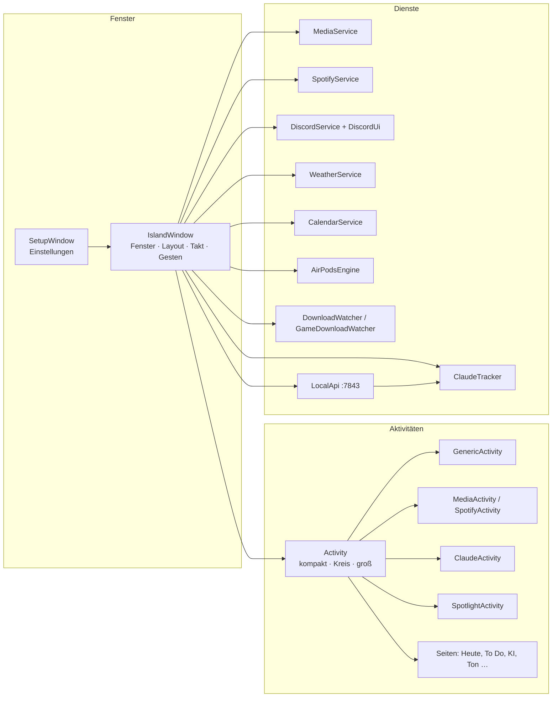

# Spezifikation – Die Geile Insel (Dynamic Island für Windows)

> Stand: 16.11.2026 · Sprache der App: Deutsch · Plattform: Windows 10 (19041+) / Windows 11

---

## 1. Überblick

**Die Geile Insel** bildet die „Dynamic Island“ des iPhones auf dem Windows-Desktop nach: eine schwarze Pille oben auf dem Bildschirm, die mit Federanimationen wächst und schrumpft, Live-Aktivitäten zeigt (Musik, Timer, Claude Code, Downloads …) und Hinweise (Nachrichten, „fertig“-Meldungen) einblendet. Aufgeklappt wird sie zu einer „großen Island“ mit wischbaren Seiten (Übersicht, Player, Heute, To Do, KI …).

### Ziele
- **Unaufdringlich:** Die Island ist fast nur sichtbar, wenn ein Hinweis kommt oder der Nutzer sie hervorholt.
- **Apple-Gefühl:** Federanimationen, Liquid-Glass-Regler, ruhige Typografie, Animationen „App im Vordergrund“.
- **Alles lokal:** keine eigene Cloud; Dienste (Spotify, Discord, Gemini, Open-Meteo, Microsoft To Do) nur, wenn der Nutzer sie einrichtet.
- **Persönlich:** eigene Katzen, Akzentfarbe, Größe, Seitenreihenfolge, Animationen pro Ereignis.

---

## 2. Technik

| Punkt | Festlegung |
|---|---|
| Sprache / UI | C# · WPF (`UseWPF`), keine XAML-Dateien – die Oberfläche wird im Code aufgebaut |
| Laufzeit | .NET 8 (`net8.0-windows10.0.19041.0`, `RollForward=Major` → läuft auch mit .NET 9/10) |
| Windows-APIs | WinRT (Medien-Sitzungen, Bluetooth, Benachrichtigungen, Geolocation, OCR), Win32 per P/Invoke, UI Automation |
| Einzelinstanz | Mutex `DynamicIsland-Einzelinstanz`; zweiter Start zeigt einen Hinweis und beendet sich |
| Datenordner | `%APPDATA%\DynamicIsland` – `einstellungen.json`, `fehler.log`, `Katzen\` (Fotos) |
| Fehler | Globale Handler fangen Ausnahmen ab und schreiben sie nach `fehler.log` (gleiche Meldung nur einmal) |
| Takt | `DispatcherTimer` mit 50 ms (20×/s) – aktualisiert Aktivitäten, Auto-Ausblenden, Abfragen |

---

## 3. Architektur



### 3.1 Hauptbausteine

| Baustein | Aufgabe |
|---|---|
| `IslandWindow` | Transparentes, randloses Topmost-Fenster (1000×580, aktiviert sich nicht). Enthält Pille, Kreis („Bubble“), Kamera/Mikro-Punkte und das Katzen-Panel. Verwaltet die Aktivitätsliste, wählt aus, was angezeigt wird (`Relayout`), animiert Größe/Inhalt, Gesten, Auto-Ausblenden, Menüs, Hotkeys. |
| `Activity` | Basisklasse jeder Anzeige mit drei Ansichten: **kompakt** (Pille), **minimal** (Kreis neben der Pille), **erweitert** (große Island). Eigenschaften: `Priority`, `IsAlert`, `ExpiresAt`, `Finished`, `CanExpand`, `PreferBubble`, `BubbleHoverWidth`. |
| `GenericActivity` | Universelle Aktivität (Symbol, Texte, Fortschritt, Knöpfe, Banner) für Hinweise, Demos und die lokale API. |
| `SetupWindow` | Einstellungsfenster im Stil der Apple-Systemeinstellungen (Seitenleiste + Karten). |
| `Ui` | Farben, Schriften, Bausteine (Text, Glyph, RoundButton, DragBar, Bar, Row3 …), `SpringEase`. |
| `LiquidGlass` | Pixel-Shader für die gläsernen Reglerknöpfe (abschaltbar → „Flach“). |
| `Settings` | JSON-Einstellungen inkl. Versions-Migrationen (`LayoutVersion`, `PagesVersion`, `TilesVersion`). |

### 3.2 Anzeige-Auswahl (`Relayout`)
1. Abgelaufene (`ExpiresAt`) und beendete Aktivitäten werden entfernt (Hinweise bleiben, solange die Maus darauf liegt).
2. **Hinweis** = neueste Aktivität mit `IsAlert`. **Live** = übrige, sortiert nach `Priority` (angepinnte zuerst).
3. Aktivitäten mit `PreferBubble` (Claude) wohnen bevorzugt im **Kreis**, außer sie wurden angetippt (angepinnt).
4. Hauptpille = Hinweis oder wichtigste Live-Aktivität; Kreis = Bubble-Aktivität oder zweitwichtigste.
5. Ist eine Seite aufgeklappt, zeigt die Pille die große Island (Seitengröße einheitlich).

---

## 4. Darstellung

| Zustand | Beschreibung |
|---|---|
| Leerlauf | Kleine Pille (124×30) oder dünner Strich (Einstellung) |
| Kompakt | Pille mit Symbol links, Inhalt rechts (z. B. Cover + Visualizer, Timer-Ring + Restzeit) |
| Kreis | Zweite Aktivität als 36-px-Kreis neben der Pille; Claude zeigt Ring + Dauer, beim Drüberfahren breit mit Text |
| Banner | Größere Pille mit Titel + Untertitel (Nachrichten, Geräte, Termine) |
| Spotlight | „App im Vordergrund“: Pille wird länger, großes App-Symbol im leuchtenden Kreis, Inhalt daneben |
| Große Island | Seiten mit Seitensymbolen oben, Katzen-Kratzbaum rechts (optional) |

**Größe der großen Island:** Grundmaß 420×232, skaliert mit `PageScale` (0,7–1) und verbreitert mit `PageWide` (1–1,45). Inhalt bekommt mehr Breite, wird nicht verzerrt. `Scale` vergrößert/verkleinert alles.

**Schatten:** liegt auf einer eigenen Fläche hinter der Pille (nicht auf dem Inhalt), damit Wischen und Animationen flüssig bleiben.

---

## 5. Bedienung

| Geste | Wirkung |
|---|---|
| Antippen | Aktivität aufklappen · nochmal: Übersicht · nochmal: zu |
| Gedrückt halten | Direkt zur Übersicht |
| Seitlich wischen (groß) | Seite wechseln; die Nachbarseite schaut beim Ziehen herein (Vorschau) |
| Seitlich wischen (klein) | ← Aktivität ausblenden · → zurückholen |
| Mausrad (groß) | Seite wechseln (Listen scrollen zuerst bis zum Ende, Regler behalten das Rad) |
| Rechte Maustaste ziehen | Island frei verschieben, auch auf andere Bildschirme; rastet nur in der Mitte ein |
| Rechtsklick | Menü mit allen Funktionen |
| Klick daneben | Große Island klappt zu |
| Maus an den oberen Rand | Versteckte Island kommt hervor |
| Kreis antippen | Pille und Kreis tauschen (anpinnen) |

### Tastenkürzel (global)

| Kürzel | Funktion |
|---|---|
| Strg + Alt + Leertaste | Übersicht |
| Strg + Alt + K | Kurzbefehle |
| Strg + Alt + D | Downloads |
| Strg + Alt + M | Discord-Mikro an/aus |
| Strg + Alt + V | Zwischenablage-Verlauf |
| Strg + Alt + A | App-Wechsler |
| Strg + Alt + G | Gemini-Chat |
| Strg + Alt + T | Text vom Bildschirm erkennen (OCR) |
| Strg + Alt + N | Neue Aufgabe (To Do) |

---

## 6. Ein- und Ausblenden

Die Island fährt nach `HideDelay` Sekunden (Standard 3 s) nach oben weg, **außer**:
- ein **Hinweis** läuft (Nachricht, „fertig“-Meldung, Spotlight, Sprachmemo),
- die Maus liegt darauf oder am oberen Rand, eine Taste ist gedrückt, ein Menü oder die Einstellungen sind offen,
- die große Island ist aufgeklappt.

Laufende Aktivitäten (Claude arbeitet, Timer, Musik, Songwechsel) holen die Island **nicht** hervor. Bei Vollbild (Spiel/Video) auf demselben Bildschirm blendet sie sich ganz aus (abschaltbar). Hängende Zustände (verpasstes MouseLeave, Menü ohne „Closed“) werden alle 0,5 s bereinigt.

---

## 7. Seiten der großen Island

Reihenfolge und Auswahl sind einstellbar (*Einstellungen → Seiten & Widgets*). Laufende Aktivitäten (Timer, Claude, Discord …) werden automatisch hinter Übersicht/Player eingefügt.

| Schlüssel | Seite |
|---|---|
| `dashboard` | Übersicht: Uhr, CPU/RAM/Akku, Kacheln (bis 12), Mini-Player |
| `calendar` | **Heute**: Wetter links, nächste 3 Termine rechts |
| `todo` | Microsoft To Do |
| `ai` | Gemini-Chat, Rechner, Text-Drop-Zone |
| `player` | Spotify- oder Medien-Player |
| `w:<id>` | Eigene Widget-Seite (bis 4 Widgets) |
| `sound` | Lautstärke, Mikrofon (schmaler Regler + Pegel) |
| `bluetooth` | AirPods-, Kopfhörer- oder Bluetooth-Seite |
| `downloads`, `clipboard`, `apps`, `brightness`, `shortcuts` | Panels |

**Seitensymbole** oben: farbig oder alle weiß (Einstellung); Claude und Discord mit eigenen gezeichneten Logos.
**Wisch-Vorschau:** zuletzt angezeigte Fassung jeder Seite wird zwischengespeichert und beim Ziehen daneben gezeigt; unbekannte Seiten als Symbol + Name. Beim Loslassen gleitet die neue Seite nahtlos weiter (Federanimation, kein Ausblenden).

---

## 8. Funktionen

### 8.1 Musik
- **MediaService:** liest Windows-Mediensitzungen (Spotify, Browser, VLC, Apple Music …), steuert Play/Pause, Spulen, Zufall, Wiederholen; Akzentfarbe aus dem Cover.
- **SpotifyService:** eigener Player über die Spotify Web API (OAuth, Redirect `http://127.0.0.1:8898/callback`): Gefällt mir, Geräte wechseln, Playlists, Lautstärke (Steuern nur mit Premium).
- **Player-Wechsler:** listet alle Quellen mit Status und Titel; Auswahl wird angeheftet, bis „Automatisch“ gewählt wird.
- **Player-Design (`PlayerUi`):** großes Cover (124 px) mit Farb-Leuchten links; rechts Titel, Künstler, Gerät/App, Spulleiste, Steuerung. Animationen: Cover schrumpft bei Pause (0,88), Songwechsel mit Überblenden + Titel-Einschub, Play-Knopf federt.
- „Zurück zum Player“ öffnet den Player immer (auch pausiert, 2 Minuten erreichbar).

### 8.2 Heute: Wetter + Kalender
- **Wetter:** Open-Meteo (ohne Konto), alle 15 min; Ort aus Einstellungen oder – nur auf Wunsch – Windows-Standort (im Hintergrund, 15 s Zeitlimit). Jetzt, 4–6 Stunden, 3 Tage.
- **Kalender:** iCal-Adressen (verschlüsselt gespeichert), Erinnerung X Minuten vorher, Ansage per Sprachausgabe, „Beitreten“ bei Online-Meetings, Countdown-Aktivität.

### 8.3 Claude Code
- **Hooks** in `%USERPROFILE%\.claude\settings.json` (UserPromptSubmit, PreToolUse, PostToolUse, Notification, Stop, SessionEnd, PreCompact) senden das Hook-JSON per `curl` asynchron an `http://localhost:7843/claude`.
- **ClaudeTracker** führt pro Sitzung eine `ClaudeActivity`: Zustände *arbeitet* (orange, drehender Ring), *wartet* (gelb, „!“), *fertig* (grün, ✓). Werkzeuge werden in deutsche Sätze übersetzt („Bearbeitet Cats.cs“, „Sucht …“, „Denkt nach …“).
- Schutz gegen sich überholende Signale (kein „arbeitet“ nach „fertig“), Aufräumen nach 10 min Stille.
- Einrichtung per Knopf in den Einstellungen; die Seite „Claude“ erscheint nur, wenn Claude installiert ist.

### 8.4 Discord
- RPC über Named Pipe (`discord-ipc-N`) mit eigener Anwendung (Client-ID/Secret).
- Sprachkanal-Ansicht mit Teilnehmern, Sprech-Ringen, Stumm/Ton-aus; „Ton aus“ zeigt das Mikro automatisch als aus.
- **Stream beenden:** über UI Automation wird der Knopf „Streaming beenden“ im Discord-Fenster gedrückt (RPC kann das nicht).

### 8.5 Nachrichten & Antworten
- Windows-Benachrichtigungen werden gespiegelt (WhatsApp, Teams …), eingehende Anrufe größer.
- **Antworten:** Eingabefeld in der Island → App wird aktiviert, Chat geöffnet (WhatsApp: Suche; Discord-DM: Direktlink; Server-Kanal: Schnellsuche), Text eingefügt und – wenn erlaubt – gesendet. Andere Apps: nur einfügen.

### 8.6 Geräte
- **AirPods:** BLE-Erkennung (Akku, Case, Ohrerkennung), Auto-Pause/-Weiter, Auto-Umschalten, AAP-Verbindung (ANC/Transparenz). Case-Popup nur bei gekoppelten eigenen AirPods.
- **Bluetooth/USB/Controller:** Meldung mit Akku-Ring; pro Gerät höchstens alle 3 h und nur nach ≥ 20 min Abwesenheit (verhindert Flackern bei Standby-Kopfhörern).

### 8.7 Downloads
- Browser-Downloads über Temp-Dateien (`.crdownload`, `.part` …) mit Größe und Geschwindigkeit.
- **Spiele:** Steam (`appmanifest_*.acf`: Bytes, StateFlags) mit Prozent, Geschwindigkeit, Restzeit; Epic ohne Prozent.

### 8.8 Werkzeuge
Timer (Ring-Design, +1/+5, Endzeit), Pomodoro (25/5/15), Stoppuhr mit Runden, Sprachmemos, Zwischenablage-Verlauf (25 Einträge, nur im Speicher, Passwörter verdeckt), App-Wechsler, Helligkeit (DDC/CI + intern), Kurzbefehle, Texterkennung (OCR) per Mittelklick oder Hotkey, Gemini-Chat.

### 8.9 Katzen
- Bis zu 4 Katzen: Vorlage (9 Rassen), Fell-/Augenfarbe, Muster, Flauschig, Zubehör (+Farbe), Größe, Charakter; optional eigenes Foto.
- Blinzeln, Schwanzwedeln, Umschauen, Hüpfen, Schnurren beim Streicheln, Einschlafen nach Ruhe (je nach Charakter).
- In der großen Island auf einem Kratzbaum; die Katze ganz oben schläft (wacht beim Streicheln kurz auf).
- Eine Vorlage zu wählen setzt eigene Farben/Muster zurück.

### 8.10 Animationen
Pro Ereignis wählbar (*Einstellungen → Animationen*): **Aus · App · Leuchten · Hüpfen · Beides**, mit Tester (▶) und „Schnell einstellen“.

| Ereignis | Spotlight-Inhalt |
|---|---|
| Claude ist fertig | Claude-Logo · Projekt · Dauer |
| Timer abgelaufen | Timer-Symbol · Uhrzeit |
| Download / Spiel fertig | Datei bzw. Spiel · Größe/Store |
| Kopieren | Zwischenablage-Symbol · Textanfang |
| Neue Nachricht / Gerät | Banner + Hüpfer |

Katzen hüpfen bei jeder Animation mit. „Bewegungen reduzieren“ (Windows) schaltet Animationen ab.

---

## 9. Schnittstellen

### 9.1 Lokale API (`http://localhost:7843`, nur dieser PC)

| Pfad | Methode | Zweck |
|---|---|---|
| `/show` | GET | Eigene Live-Aktivität anzeigen/aktualisieren. Parameter: `id`, `title`, `sub`, `left`, `right`, `detail`, `icon` (Hex-Glyph), `emoji`, `color`, `progress` (0–1), `banner=1`, `width`, `seconds` (als Hinweis) |
| `/hide` | GET | Aktivität `id` entfernen |
| `/claude` | POST | Claude-Code-Hook-JSON entgegennehmen |

Beispiel: `http://localhost:7843/show?id=fussball&title=FCB%202:1%20BVB&right=67'&emoji=⚽`

### 9.2 Externe Dienste (nur wenn eingerichtet)
Spotify Web API · Discord RPC (lokal) · Microsoft Graph (To Do, Gerätecode-Anmeldung) · Google Gemini · Open-Meteo (Wetter + Geocoding) · iCal-Adressen des Nutzers.

---

## 10. Einstellungen

Gespeichert in `%APPDATA%\DynamicIsland\einstellungen.json`. Gruppen (Auswahl):

| Gruppe | Schlüssel |
|---|---|
| Größe & Position | `PageScale`, `PageWide`, `Scale`, `PosX`, `PosY`, `MonitorName` |
| Aussehen | `AccentColor`, `NavIconsColor`, `IdlePill`, `Material`, `GlassTint`, `SpotifyColor` |
| Ausblenden | `AutoHide`, `HideWithActivities`, `HideDelay`, `HideInFullscreen` |
| Animationen | `AnimModes` (Ereignis → Art) |
| Seiten | `Pages`, `WidgetPages`, `DashboardTiles` |
| Hinweise | `ShowVolume`, `ShowClipboard`, `ShowCapsLock`, `ShowBluetooth`, `ShowPrivacy`, `MirrorNotifications`, `ReplyAutoSend`, `ShowDownloads` |
| Katzen | `CatsMode` (`expanded`/`always`/`off`), `CatsStayVisible`, `Cats` |
| Dienste | Spotify-, Discord-, To-Do-, Gemini-, Kalender-, Wetter-, AirPods-, Claude-Einstellungen |

Migrationen laufen beim Laden automatisch (z. B. neue Seiten einfügen, „Wetter“ in „Heute“ zusammenführen, alte Animations-Schalter übernehmen).

---

## 11. Datenschutz & Sicherheit

- Die App sendet nichts an eigene Server; Telemetrie gibt es nicht.
- Die lokale API lauscht nur auf `localhost`.
- **Verschlüsselt (DPAPI, nur im eigenen Windows-Konto lesbar):** Gemini-Schlüssel, To-Do-Token, Kalender-Adressen.
- **Derzeit unverschlüsselt** in `einstellungen.json`: Spotify- und Discord-Tokens sowie das Discord-Client-Secret (→ offener Punkt).
- Zwischenablage-Verlauf nur im Arbeitsspeicher; passwortähnliche Einträge werden verdeckt.
- Wetter: nur Ortsname bzw. ungefähre Koordinaten an Open-Meteo.

---

## 12. Bauen & Veröffentlichen

| Weg | Befehl |
|---|---|
| Starten (Entwicklung) | `Starten.bat` → `dotnet build -c Release` und Start |
| Einzelne EXE (benötigt .NET) | `Als-EXE-bauen.bat` → `dotnet publish -r win-x64 --self-contained false -p:PublishSingleFile=true` |
| Eigenständige EXE (geplant für Releases) | `dotnet publish -c Release -r win-x64 --self-contained true -p:PublishSingleFile=true -p:IncludeNativeLibrariesForSelfExtract=true` |

Autostart: *Einstellungen → System → Mit Windows starten* (Registry `HKCU\…\Run`).

---

## 13. Projektstruktur

```
DynamicIsland/
├─ Program.cs              Einstieg, Einzelinstanz, Fehlerprotokoll
├─ IslandWindow.cs         Fenster, Layout, Gesten, Takt, Menüs, Ereignisse
├─ SetupWindow.cs          Einstellungsfenster
├─ Ui.cs                   Design-Bausteine, Farben, Federanimation
├─ Activities/
│  ├─ Activity.cs          Basisklasse + GenericActivity
│  ├─ Activities.cs        Medien-Player, Timer + Ring, Stoppuhr, Sprachmemo, Uhr, Übersicht
│  ├─ SpotifyPlayer.cs     Spotify-Player, Geräte-/Playlist-Liste
│  ├─ PlayerUi.cs          Gemeinsames Player-Layout + Animationen
│  ├─ Spotlight.cs         „App im Vordergrund“
│  ├─ CalendarActivity.cs  Seite „Heute“ (Wetter + Termine)
│  ├─ WeatherActivity.cs   Wetter-Widget
│  ├─ TodoActivity.cs, AiActivity.cs, Panels.cs, Widgets.cs
│  ├─ DiscordVoice.cs, ReplyActivity.cs
│  ├─ AirPodsActivity.cs, HeadphonesActivity.cs, BluetoothActivity.cs
│  ├─ Cats.cs              Katzen, Kratzbaum
│  ├─ Logos.cs             Gezeichnete Claude-/Discord-Logos
│  └─ Demos.cs             Vorführ-Aktivitäten
├─ Services/
│  ├─ MediaService.cs, Spotify.cs, AudioService.cs
│  ├─ Discord.cs, DiscordUi.cs, Notifications.cs
│  ├─ ClaudeTracker.cs, LocalApi.cs
│  ├─ Weather.cs, CalendarService.cs, TodoService.cs, Gemini.cs
│  ├─ AirPods.cs, AirPodsAap.cs, SystemInfo.cs (Bluetooth, Werte)
│  ├─ Downloads.cs, GameDownloads.cs
│  ├─ ScreenOcr.cs, SystemTools.cs, Native.cs, LiquidGlass.cs
│  └─ Settings.cs
└─ docs/                   Grafiken für die README
```

---

## 14. Bekannte Einschränkungen & offene Punkte

- **Release-EXE** auf GitHub fehlt noch (eigenständig, ohne .NET-Installation).
- **Eine Island pro Bildschirm** ist nicht umgesetzt (derzeit eine Island, frei auf jeden Bildschirm verschiebbar).
- **Tokens** für Spotify/Discord sollten wie die übrigen Zugangsdaten mit DPAPI verschlüsselt werden.
- **WhatsApp-Antworten** öffnen den Chat über die Suche – bei ähnlichen Namen kann der erste Treffer falsch sein (deshalb „direkt absenden“ abschaltbar).
- **Hotkeys:** beim Neu-Registrieren werden nur die IDs 1–6 abgemeldet, registriert werden 1–9.
- **Epic-Downloads** ohne Prozentangabe; Steam aktualisiert den Fortschritt teils sprunghaft.
- **Emojis** (Wetter) werden von WPF einfarbig gezeichnet.
- Discord „Stream beenden“ hängt von der Beschriftung im Discord-Fenster ab (deutsch/englisch erkannt).
